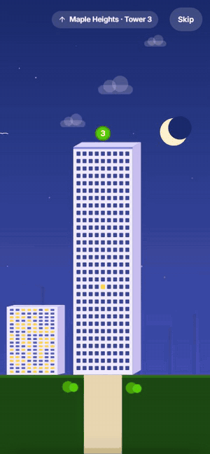
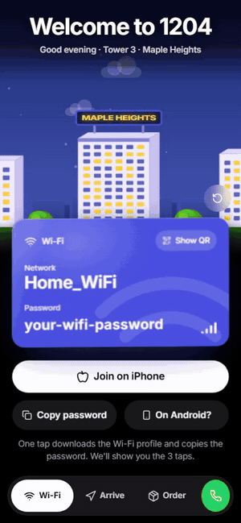

# My Works

Everything Dev designs and builds, in one place.

## Apps

### Web apps

#### [Home Page App](apps/webapps/home-page-app)
*Working name.* A guest web app for a flat: one-tap Wi-Fi on Android and iPhone, the route from the road to the right gate, every delivery app with the address ready to paste, and the hosts one tap away. Built with an animated night-time society scene and Duolingo-style motion.

|  |  |
|:---:|:---:|

#### [Calm Home TV](apps/webapps/calm-home-tv)
A fast, calm home screen for TVs that replaces an ad-filled launcher with one quiet screen: greeting, weather, your usual apps at this time of day, a gliding dock, and a PS4 auto-switch. Smooth at 60 fps on a cheap TV, and fully reversible.

### Career app

#### [Growth](apps/growth)
A personal career growth app you run with Claude Code. It interviews you, maps your skills against the roles you want, plans your weeks, builds an honest CV where every fact has a source, and shows it all in a calm local web app. **G mini** uses the same engine to interview someone you are helping and hand them a deep PDF report. The app and its three Claude skills live together in [`apps/growth`](apps/growth), with one installer.

**Documentation:** [Growth docs](apps/growth/docs/README.md)

## Skills

Claude skills ship with the app they drive: see [`apps/growth/skills`](apps/growth/skills) for Growth, the coach and G mini.

---

Screenshots use placeholder names and details. Passwords, phone numbers, addresses and signing keys are kept out of this repo.
