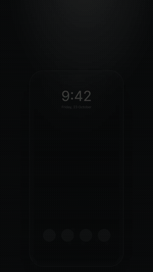
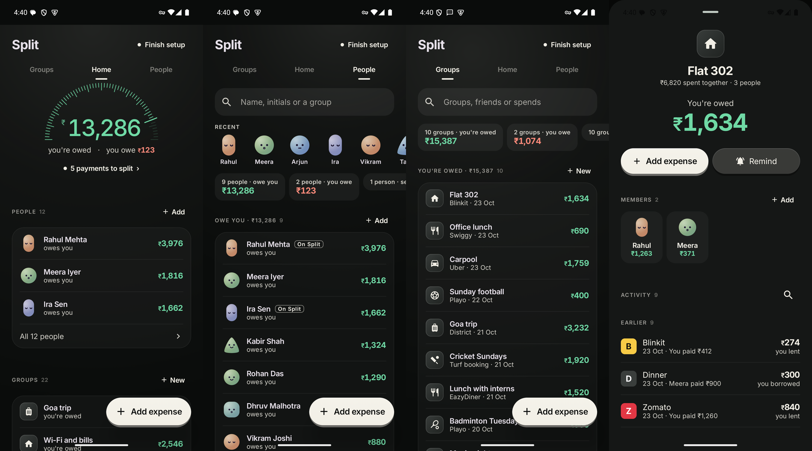

# Split

An Android app that splits shared spending the moment you pay. When your bank texts you about a payment to Zomato, Swiggy, Blinkit or Uber, Split asks if it was shared and splits it with the same people as last time, in one tap. It keeps track of who owes whom, settles up, and drafts WhatsApp or SMS reminders. It never moves money.

|  |
|:---:|
| [Watch the full quick tour (55 s)](docs/media/quick-tour.mp4) |

## What it does

- **Spots shared payments.** Reads bank and UPI debit messages on the phone. Your messages never leave your phone.
- **One-tap split.** Repeats the last split for the same shop: same people, same shares, same group. Undo is one tap.
- **Three swipeable pages.** Groups ← Home → People. Home shows one total and the payments waiting to be split; the side pages have search (names, initials, groups or spends), recents, and totals with counts.
- **Splitwise-style model.** Every expense has a payer and shares, payments are expenses too, and balances net out per person across groups.
- **Groups and people.** Add members to a group, and a duplicate check stops the same person being added twice (by name or phone).
- **Settle up and remind.** Settling up spreads across groups; reminders open WhatsApp or SMS with the amount filled in.
- **Syncs without a server.** Friends who have the app stay in sync through tagged messages.
- **Smarter detection (planned).** An opt-in classifier, Jev, would judge unknown shops from just the shop name, an amount band and the time of day.

## Videos

| Video | Length | Size |
|---|---|---|
| [Quick tour, portrait](docs/media/quick-tour.mp4) | 55 s | 720×1280 |
| [Full walkthrough](docs/media/walkthrough.mp4) | 90 s | 1920×1080 |
| [Promo, landscape](docs/media/promo-landscape.mp4) | 60 s | 1920×1080 |
| [Promo, portrait](docs/media/promo-portrait.mp4) | 60 s | 1080×1920 |

## Build

Kotlin, Jetpack Compose and Material 3. Open the folder in Android Studio, or run `./gradlew assembleDebug` with JDK 21 and the Android SDK. `build.ps1` is the Windows build script used during development.

Design notes: [PRODUCT.md](PRODUCT.md), [DESIGN.md](DESIGN.md), [Splitwise audit](docs/splitwise-audit.md), [attention map](docs/attention-map.md).

---

Screenshots and videos use sample people and amounts.
