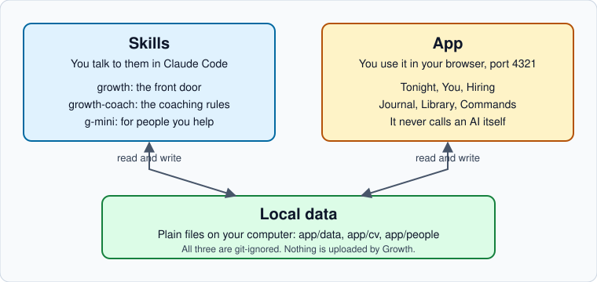

# Welcome to Growth

Growth is a personal career growth app that you run with Claude Code. It answers two questions every night: what skill should I build next, and what should I do to get seen.

It keeps the answers in plain files on your own computer. Claude Code does the thinking that a web page cannot: it diagnoses your gaps, researches your field, critiques your work and writes your plan. The app shows you the result, one thing first.


Growth runs on your Claude Code subscription. It needs no API key and asks for none. Everything it saves stays in folders on your computer.


## Who it is for

Growth is built for people in design, PR and communications, and marketing. It works as one connected graph: where you are, where you want to be, and what fills the gap between them. The interview and the question bank do not assume a field, a currency or a channel, so it also runs for someone outside those three.

It suits you if you want an honest picture of your skills, a plan you can finish in about an hour a night, and a CV where every fact has a source.

It does not apply for jobs, send messages or post anything for you. It drafts. You send.

## The three pieces at a glance

| Piece | Where it lives | What it does |
|---|---|---|
| App | `app/` | A Next.js app on port 4321. It shows tonight's two tasks, your skill levels with the evidence behind each, your CV and case studies, your journal and a library. It never calls an AI. When it needs Claude, it adds a request to a queue. |
| Skills | `skills/` | Three Claude Code skills: `growth` (the command front door), `growth-coach` (the coaching rules) and `g-mini` (a separate tool for people you help). |
| Local data | `app/data`, `app/cv`, `app/people` | Plain JSON and HTML files. They are the only memory. Back them up like any folder. |

## The loop in one minute

1. You work in the app. You do tonight's step and press **Hand it in**.
2. The app queues anything that needs Claude, and says "Waiting on Claude".
3. In Claude Code you say `answer it`.
4. Claude reads the queue, does the work and writes the result into your data files.
5. You open the app and see the result.

Read [How it fits together](concepts/how-it-fits-together.md) for the full picture.

## Start here

- [Install](getting-started/install.md): clone the repo, run the installer, start the app.
- [Your first run](getting-started/first-run.md): the `growth start` interview.
- [The daily loop](getting-started/daily-loop.md): what a normal evening looks like.

## What Growth will not do


Growth never invents a number, a title or a result. A missing fact becomes a `[NEEDS: ...]` marker and Claude asks you for the real one. Read [Honesty rules](concepts/honesty-rules.md).


It also will not credit you for other people's work, treat Claude's opinion as evidence, send or publish anything, or promise an outcome. Plans say "ready around X, range Y to Z", never a guarantee.

## Helping someone else

G mini is a separate, smaller tool for giving a friend or colleague a hand with one career move. One interview, one PDF report. It never reads your own Growth data. See [G mini](skills/g-mini.md) and [Help someone with G mini](guides/help-someone-with-g-mini.md).

## Source

The code, the skills and these docs live in the `my-works` repository under `apps/growth`. See the [Growth README](../README.md) for the short version.
