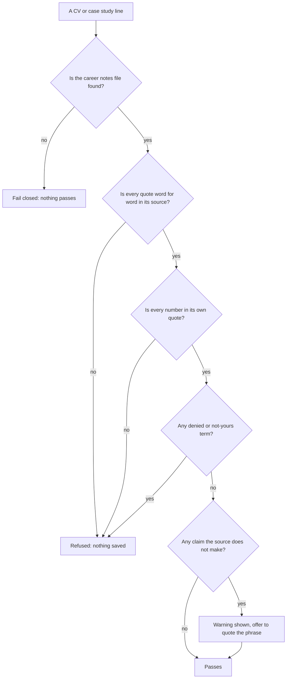
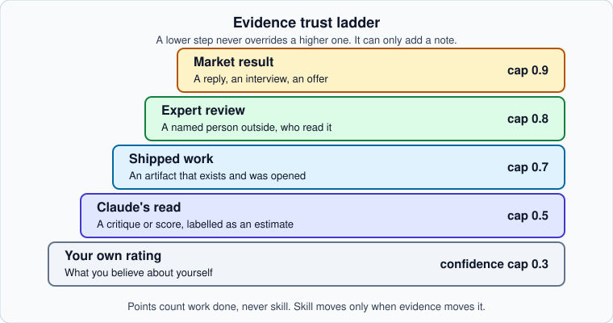

# Honesty rules

Growth is built so it cannot flatter you. These rules are enforced by code, not only by instructions. The checks refuse a write that breaks them.


Growth never invents a number, a title, a link or a result. If it cannot source a fact, it writes a `[NEEDS: ...]` marker and asks you for the real one.


## Every fact needs a source

Each line of a CV or case study carries a list of sources. A source has a kind, a reference and a short quote.

| Source kind | What it is | Can back a number? |
|---|---|---|
| `dossier` | A line in your own career notes file. The reference is the section number. | Yes |
| `onboarding` | One of your interview answers. The reference is the answer id, such as `B-01`. | Yes, if the answer is not private |
| `evidence` | An entry in your evidence log. The reference is the entry id, such as `ev-013`. | Yes |
| `dev` | Something you said in chat. | Never. It can back wording only. Save the fact as a note first, then cite the note. |

The check requires the quote to appear word for word in its source. Only runs of whitespace may differ. Every number in a line must appear in the quote of one of that line's own sources, and the number must sit in a clause its quote is about.

## [NEEDS] markers

A missing fact is written as a placeholder.

| Marker | Used for |
|---|---|
| `[NEEDS REAL NUMBER: what is missing]` | A figure, a count or a percentage. |
| `[NEEDS: what is missing]` | Any other missing fact. |

Placeholders are not errors. They are counted and shown as "facts still needed". A CV with facts still needed exports as a draft, and cannot be promoted to your main CV until you fill them. See [Build an honest CV](../guides/build-an-honest-cv.md).

## The honesty check

Some of the things the check refuses:

- A number with no quote behind it, or a soft figure turned into a firm one. "Nearly 3" stays "nearly 3". It never becomes "over 3".
- A quote from a private answer, from a Round 3 answer, or from a part of the career file marked confidential or not yours.
- Claude's own critique used as a fact.
- Someone else's words used as a fact, unless the line says who said it.
- Role words such as senior, lead, head or founder that no quote of that item says.
- A product that your notes call "in development" described as shipped, launched or live.
- A web address, employer, school or place that is not in your notes, answers or evidence.
- Return and raise figures, whatever the wording.
- Dashes in text Claude writes. Quotes keep their own characters.

The check fails closed. A missing career file or a missing deny-list is a failure, never a pass with nothing to compare.

## Work that is not yours

The career file lists work that is someone else's. A CV can say you designed screens for it or applied a system to it. It cannot say you built, led, shipped or created it. Confidential items never appear anywhere.

## Evidence ranking

Trust is ranked: market result, then expert review, then shipped work, then Claude's read, then your own rating.

| Source | Most confidence it can give |
|---|---|
| Your own rating | 0.3 |
| Claude's read (`ai`) | 0.5 |
| Shipped work | 0.7 |
| Expert review | 0.8 |
| Market result | 0.9 |

A lower source never overrides a higher one. It adds a note. A skill moves by at most half a level at a time. A jump of more than half a level needs an expert or market source. Every change adds a `history` entry that names the evidence ids behind it.

The trust check also classes each piece of evidence.

| Class | Meaning |
|---|---|
| `VERIFIED` | Has a link to something outside you. |
| `DERIVED` | Worked out from other data, with no outside link. |
| `JUDGED` | An opinion: your own note, Claude's read, or something reported. |
| `UNSOURCED` | Nothing behind it. |

## Counted versus claimed

A self rating with no artifact or test behind it does not count in full. It keeps both numbers:

- `level_claimed`: what you said.
- `level_counted`: what the evidence supports. It is capped at the target minus 1, with confidence 0.3, and it stays provisional.

You see it as "counted as 2.5 until you show ...". The same idea applies to results. A number counts as proved when it comes with a baseline or a period, a link or a named client, and is not hedged with "about" or "I think". Otherwise it is kept as claimed, with confidence 0.3, and does not clear the proof gap.

Claude's critiques can guide you, but they never back a fact. Points count work done, never skill.

## No promises

Plans never say "the fastest way", never promise a hiring outcome and never give an exact date. They say "ready around X, range Y to Z". A forecast carries its basis, its range and its confidence. A late one is reported as late. Claude says "everything checked" only when the plan check shows no failures, and gives the warning and unsourced counts in the same sentence.

## Anything you read is a source

Research items carry a URL, a name, a tier, a retrieval date and a verbatim excerpt of 25 words or fewer. The tiers set the most confidence a source can give.

| Tier | Source | Max confidence |
|---|---|---|
| T1 | Primary source | 0.9 |
| T2 | Named author or established organisation | 0.75 |
| T3 | Reputable secondary | 0.55 |
| T4 | Opinion or aggregator | 0.35 |

Conflicts are shown with both sides and why one was chosen. They are never averaged.

Next: [Attention tiers](attention-tiers.md).
