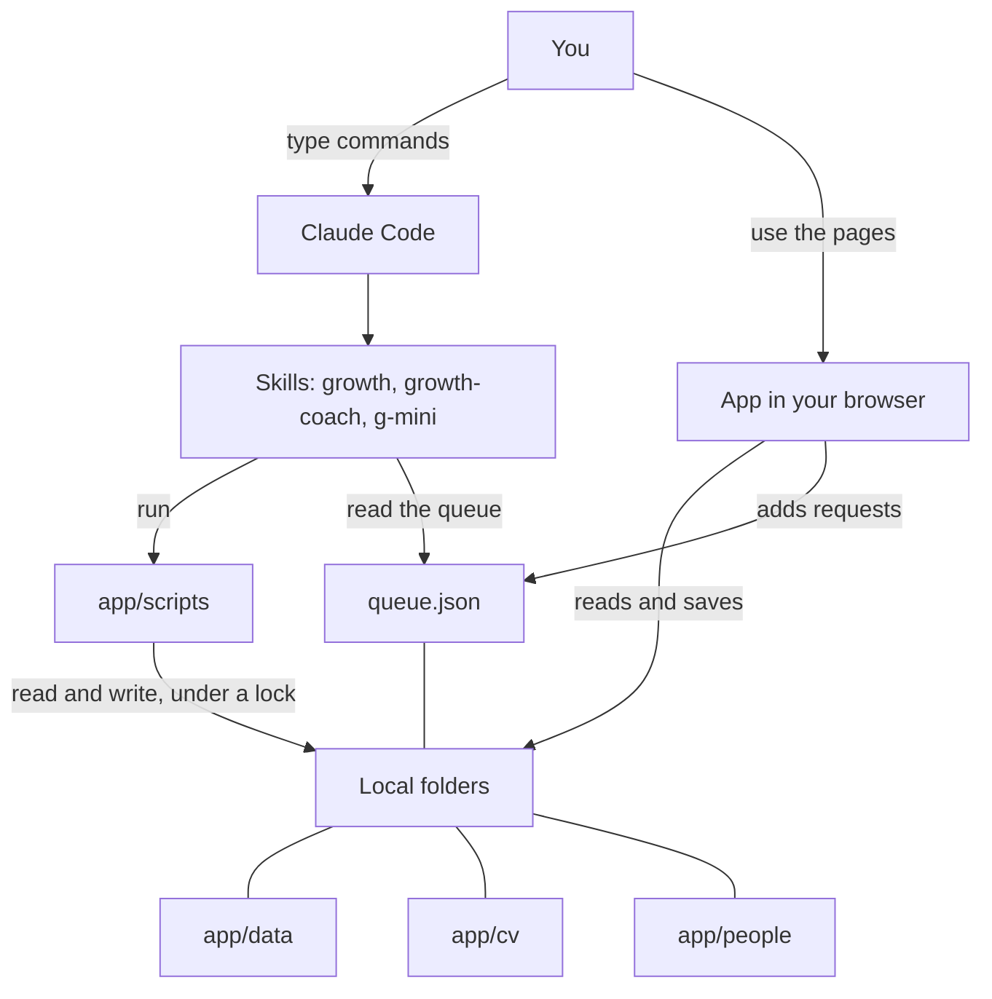
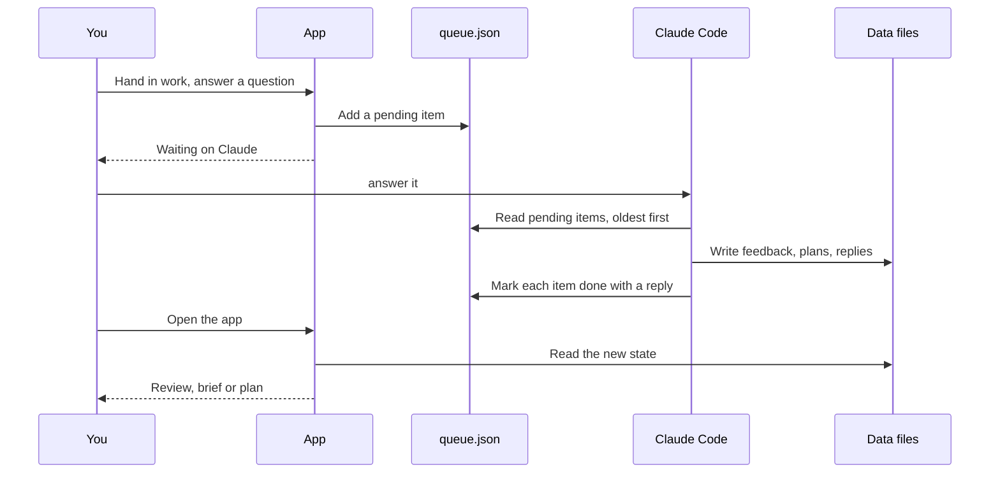
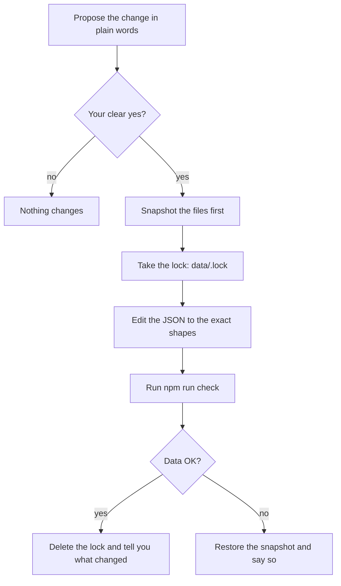
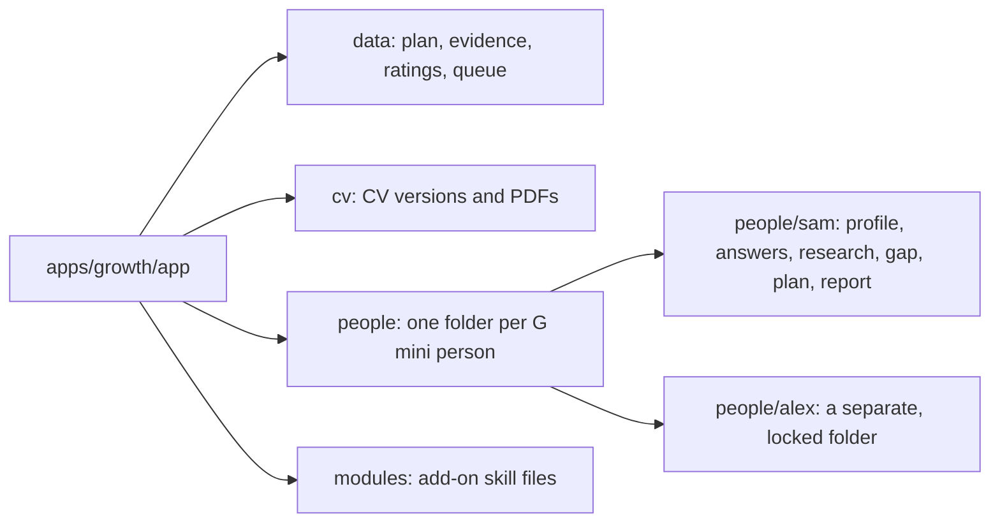

# How it fits together

Growth has three parts that read and write the same folders: the app, the skills and your local data. This page shows how they connect.

## Architecture

| Part | Job |
|---|---|
| App | Shows your state and takes your input. It has no AI in it. |
| `growth` skill | The command front door. Routes what you say to the right protocol. |
| `growth-coach` skill | The coaching rules and the data shapes. Wins any disagreement about coaching. |
| `g-mini` skill | A separate tool for other people. It never touches your Growth. |
| Scripts | Small programs in `app/scripts` that apply every write with the same logic the app uses, then check the result. |
| Data | Plain JSON and HTML files. The only memory. |

## The queue loop

The app cannot think, so it asks. Anything that needs Claude goes into `queue.json` as a request. You tell Claude to answer it in Claude Code. Claude writes the result back, and the app shows it.

The queue holds eight kinds of request.

| Type | What it is |
|---|---|
| `critique` | A review of something you handed in. |
| `research` | A short brief on a skill. |
| `test` | A scenario test to write or to score. |
| `plan` | Your weekly review, so Claude can plan the next week. |
| `answers` | Answers to the questions Claude asked you. |
| `ask` | An older question or change request. The app no longer writes new ones. |
| `picks` | A request for library picks. |
| `goal` | A changed goal, so Claude can re-plan around it. |

Every handled item must be closed with a reply or feedback. The data check enforces that.

## How every write stays safe

Any command that changes data follows the same protocol.

Some commands skip the proposal because you just asked for exactly that thing: `done`, `later`, `journal add`, `pace`, `remember`, `undo`, and the CV commands you asked for. CV and case study commands write through `cv-act.mjs`, which takes the lock and makes the one snapshot itself.

`undo` puts the files back as they were before Claude's last change. The app also keeps the previous version of every file in `app/data/.backups/` (the last 40 per file), and its error page offers to restore the last good copy.

## Data folders

`data/`, `cv/`, `people/` and `research/` are git-ignored. The full list of files is in [Data files](../reference/data-files.md).

## Where each piece runs

| You do this | It runs in |
|---|---|
| Do tonight's task, read a review, keep a journal | The app. |
| Say `answer it`, `plan my week`, `build my CV` | Claude Code, on your computer, from any folder. |
| Build a G mini report | Claude Code, with the person next to you. |

The Claude app and phone chats cannot read your files, so the skills do not run there. Claude Code on your computer is the only place you talk to Claude.

Next: [Data and privacy](data-and-privacy.md).
