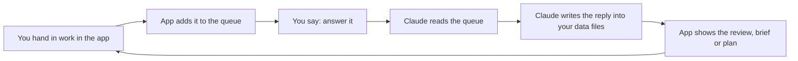

# The daily loop

Once you have a plan, a normal evening is short. You do one step in the app, and you go to Claude Code only when the app says Claude owes you something.

## An evening

1. Open http://localhost:4321. You land on [Tonight](../app/tonight.md).
2. Read the one thing it puts first. Tonight has two tasks: one skill task and one reach task (a getting-hired task). Each is 30 minutes or less. Never more than 60.
3. Do the step. Press **Hand it in** (key `H`), add a link, a file or a note.
4. Write one line about how tonight went, or press `J` to open the [Journal](../app/journal.md).
5. If the app says something is queued for Claude, open Claude Code and say `answer it`.
6. Go back to the app to see Claude's review, brief or plan.

Short on time or energy? Pick 30 or 15 minutes at the top of Tonight. The path shrinks to one task, or one step of it. The rest moves to your next evening at no cost.


Skipping a night costs nothing. What you do not finish carries over. Growth uses no streaks and no penalties, and it says nothing about missed nights.


## The loop

## Sunday

A short review plans the next week. Any skill with enough work behind it gets a new estimate from Claude, and may move half a level (Mid to Mid+, for example). The plan engine also does a weekly check on Sunday. Read [Plan your weeks](../guides/plan-your-weeks.md).

## The six everyday commands

Everything else works in plain words.

| Say | What happens |
|---|---|
| `where do I stand` (or `/growth`) | Where things stand, what is on tonight, anything Claude owes you. |
| `answer it` | Claude works through everything the app queued (reviews, plans, tests). |
| `change my plan` | Makes the week lighter, moves a gap or changes your goal, after your yes. |
| `look at my CV` | Reviews your CV or any piece of work and says what to change first. |
| `update my library` | Finds and scores things worth reading, watching or hearing this week. |
| `add a skill file` | Adds someone else's skill file as an add-on, after a safety check. |

Plain words also work: "I'm stuck on this task", "I only have 20 minutes", "I feel like a fraud", "read my journal". See [Commands](../reference/commands.md).

## Keys in the app

| Key | What it does |
|---|---|
| `O` | Opens tonight's task. |
| `H` | Hands the task in. |
| `J` | Opens the journal to write one line. |
| `C` | Opens the [Commands page](../app/commands-page.md). |
| `1` to `6` | Switches pages in menu order: Tonight, You, Hiring, Journal, Library, Commands. |

## While Claude works

When Claude is updating your data, the app shows "Claude is updating your data" and holds your saves, so you never overwrite each other. It uses a lock file for this. See [Troubleshooting](../reference/troubleshooting.md) if it ever gets stuck.
