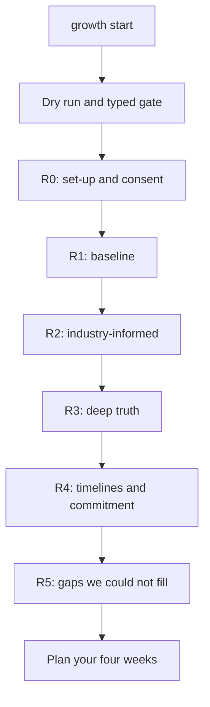

# Your first run: growth start

`growth start` is the onboarding interview. It rebuilds your starting point in rounds of questions. You answer in Claude Code, and Claude writes each answer into the app.

## Before you start

1. Start the app: run `npm run dev` in `app/`.
2. Open Claude Code in any folder.
3. Say `growth start`.

You can answer in sittings of about 20 minutes. Say `skip` to any question you do not want to answer, `I don't know` if you do not know, or `pause` to stop. Pause works in the middle of a question.

## What happens first

Claude checks your data and shows you a dry run. It lists what would be archived, blanked and kept. Nothing is erased yet.

If you want to start from a clean page, Claude asks you to type this exact phrase as your own message:

```
ERASE MY GROWTH DATA AND START OVER
```

Nothing else works. Not "yes", not "ok", not a paraphrase. The phrase is good for one reset and expires after 15 minutes. The reset archives your old data to `app/data/prior.json` and backs up every file. Nothing is deleted. If you would rather keep your data and answer on top of it, say so and Claude skips the erase.


Reset is "archive then blank". The backup folder is never pruned, and one command puts the files back.


## The rounds



| Round | Name | What it covers |
|---|---|---|
| R0 | Set-up and consent | Minutes per sitting, tone, what is off limits, how deep to go (quick, standard or deep), currency, pay unit, country, field and proof. It ends with the ground rules and your yes to start. |
| R1 | Baseline | Where you are now: the must-answer questions B-01 to B-36, plus the optional ones for your depth. This includes the role you want and your pay range. |
| R2 | Industry-informed | Claude researches your target role first: level ladders, live job posts and pay. It writes a researched rubric, maps your skill areas to it, then asks questions built from that research. |
| R3 | Deep truth | The hard, private questions. Needs your recorded yes. Answers stay private. |
| R4 | Timelines and commitment | The dates you want to hit, what would tell you at the end of week 4 that you are on track, and how that fits your hours. Open contradictions are decided here. |
| R5 | Gaps we could not fill | No new questions. Every unknown gets a way to find out, a task or an owner, and a due date. Then a plan. |

Every question says why it is asked and what it changes. You will see a line like this before each one:

```
Why I am asking: <why>. What changes: <changes>.
[Round 2 of 5 | question 4 of 6 this sitting | hard: yes or no | say skip, I don't know, or pause any time]
```

## Consent and safety

- Rounds R1 to R4 each need your recorded yes before the first answer is saved.
- After each block of three hard questions Claude asks how you are holding up. You can continue, pause or skip the rest of the round.
- Round 3 answers are private. They never go into a CV, outreach, journal or any public copy. Say `forget R3` to delete them.
- Claude does not diagnose and does not give therapy. If you write about hurting yourself, it stops asking, shows a helpline for your country and pauses. Your words are not saved as an answer.

## Unknowns become the course

Every "I don't know" becomes a row in `unknowns.json` with a way to find out and a task of 15 to 60 minutes. The kinds are a small test, research Claude does, an evidence task, a question for a named person (Claude drafts it, you send it) and seven days of observing.

## When it is done

Claude runs a completeness check. `PASS` or `WARN` lets you finish. A `FAIL` does not. Then it offers to build your four weeks.

Say these next, in this order:

1. `plan my four weeks`
2. `update my library`
3. `build my CV` (see [Build an honest CV](../guides/build-an-honest-cv.md))

## Other onboarding commands

| Say | What happens |
|---|---|
| `resume growth start` | Carries on from your last answer. |
| `pause` | Stops now and keeps everything. |
| `onboarding status` | Shows the round, what is answered, what is unknown and what does not add up. Changes nothing. |
| `redo round N` | Reopens one round. Earlier answers stay as history and each is asked again with "last time you said X, still true?". |

See [Commands](../reference/commands.md) for the full list, and [Scripts](../reference/scripts.md) for the onboarding scripts behind it.
