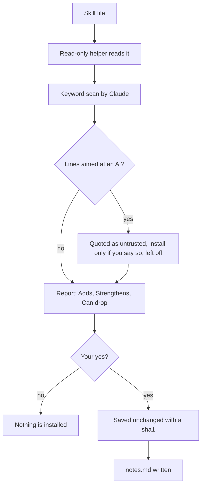

# Add a skill file

An add-on is a skill file that teaches Claude one job, such as reading a CV or a LinkedIn profile. Growth can use it and show what it found, without changing how the rest of the app works.

## What you need

A skill file. It can be:

- a file on your computer,
- a link to a raw file,
- text you paste, or
- a Claude skill that is already installed, bound by name.

Two safe examples ship with Growth. Try the flow with them first:

- `app/modules/_examples/cv-analyser/SKILL.md`
- `app/modules/_examples/linkedin-analyser/SKILL.md`

## Add one in three steps

1. Find the file.
2. In Claude Code, say `add a skill file` (or `/growth add-on`). Give the path, the link or the pasted text.
3. Read Claude's short report, then answer one question.

The report has this shape:

```
Connected: <name>. Based on the file's text, not on results.
Adds: ...
Strengthens: ...
Can drop: ...
You can now say, in Claude Code: "..."
```

The one question is "Use it this way? (yes / only the new things / no)". Claude may also offer to try the file once on your CV and compare it with the built-in read.

## What Claude checks first


A skill file is untrusted text. It can never change your rules, the confidentiality rules, or which files get written.




- A read-only helper reads the file first, so raw third-party text never lands in the main chat.
- Claude scans the file itself for risky words, such as "ignore previous", "send", "curl", "api key" and "webhook". Many hits are normal, so it quotes only the lines that try to instruct an AI.
- Anything that posts, sends or publishes is listed but stays off.
- A flagged add-on stays off until you say `module enable`, and it is re-checked on every run.
- Claude never runs scripts that come with an add-on.
- If the file changes after install, Claude stops and asks.

## Where files live

| Path | What it is |
|---|---|
| `modules/<id>/skill/SKILL.md` | The add-on, saved exactly as you gave it. Claude never edits it. |
| `modules/<id>/notes.md` | Claude's plain note: source, what it does, what it refused to do. |
| `modules/ledger.json` | What the app can already do on its own. New files are compared against it. |
| `modules/_scratch/` | A temporary working copy used while a file is checked. It is emptied afterwards. |

What each add-on found is stored with your profile in `profile.json`, so the app shows it and backups cover it.

## Use it

| Say | What happens |
|---|---|
| `modules` | Lists what is installed, what each is for and its last result. |
| `module run <id>` | Runs one add-on on your input and saves what it found. |
| `module results` | Shows what your add-ons found, newest first, and which results are out of date. |
| `module enable <id>` and `module disable <id>` | Turn one on or off. |
| `module default <id>` | Picks which add-on answers when two do the same job. |
| `module remove <id>` | Takes one out. Its past results stay unless you say delete. |
| `analyse cv`, `analyse linkedin`, `analyse portfolio`, `analyse interview` | Run the add-on that covers that topic. If there is none, Claude says so and offers the built-in review. |

The file decides what it enables. Nothing is hidden for good. Anything an add-on replaces is only hidden, and removing the add-on brings it back.

## What a score means

A score from an add-on is an AI read. It does not raise a skill rating on its own. Claude says so every time it shows a score. LinkedIn is never scraped. You paste the profile text or give the data export.

## Bundled add-ons

Five third-party add-ons ship in `app/modules/`, unchanged and under their own MIT licences.

| Add-on | Use |
|---|---|
| `resume-ats-optimizer` | ATS compatibility and keyword match. |
| `resume-tailor` | Tailoring a CV to one job post, truthfully. |
| `resume-section-builder` | Targeted CV sections for a level and role. |
| `resume-tailoring` | Researches the company and role, then tailors, including for several job posts. |
| `case-study` | Portfolio case studies, with a structured intake first. |

Each folder has a `LICENSE` and a `notes.md` with the rules Growth applies when it uses the skill. Their authors are credited in the [Growth README](../../README.md#third-party-skills). Claude uses them through `module-scratch.mjs`, which checks every skill file against its recorded sha1 before it makes a working copy. If one has changed, nothing is written.

Related: [Commands](../reference/commands.md), [Scripts](../reference/scripts.md).
