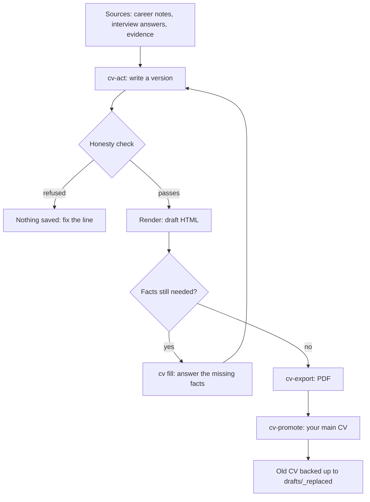

# Build an honest CV

This guide takes you from your notes to a CV that passes the honesty check, exported as a PDF and saved as your main CV. Every fact in it has a source.

## Before you start

- Finish `growth start`, or at least have some interview answers and evidence logged. See [Your first run](../getting-started/first-run.md).
- Set `GROWTH_DOSSIER` to your career notes file. Without it the honesty check fails closed. See [Install](../getting-started/install.md#settings).
- Have Microsoft Edge installed for PDF export, or set `GROWTH_EDGE`.

## The pipeline

## Steps

### 1. Build a version

Say `build my CV`. Claude reads your career file, your interview answers and your evidence. It writes a new version, `v1`, `v2` and so on, through `cv-act.mjs`. The earlier version stays as it was.

Each bullet has sources. If Claude cannot source a fact, it writes a placeholder instead of guessing.

### 2. See what is still needed

Claude runs `cv-check.mjs`. A pass reads "Every fact has a source". Placeholders are not errors, and Claude reports them in plain words: "3 facts still needed". Each is listed as `still needed #N`. You see them in the app too, under **Your CV** on [Hiring](../app/hiring.md).

### 3. Fill the gaps

Say `fill in my CV`. Claude asks only for the facts still missing, in one list. You can skip any of them. For each answer Claude saves your words as an evidence note first, then cites that note. Numbers cannot rest on what you said in chat. They must rest on a saved note. All the fills go into one new version.

### 4. Tailor it for a job

Say `tailor my CV for this job` and paste the job post. Claude makes a new version for that job. It reorders and rewords what is true. It adds no skill and no number.

Say `check my CV against this job` for a keyword match. The result is labelled "AI estimate". A keyword may be listed as matched only if it is in your CV's own words.

To rewrite one part, such as the summary, say `rewrite my summary`. A rewrite goes into a new version, so your earlier text is not lost.

### 5. Save a PDF

Say `save my CV as a PDF`. It runs `cv-export.mjs`, which uses headless Edge and saves `app/cv/drafts/CV_vN.pdf`.

- If the honesty check fails, it refuses.
- If facts are still needed, it exports only as a draft, and stamps the footer "Draft: N facts still needed".
- It never touches your main CV file.

### 6. Make it your main CV

Say `use this CV`. It runs `cv-promote.mjs`, which:

1. needs the honesty check to pass,
2. needs no fact still needed,
3. needs a PDF saved after the version's last change,
4. copies your current `CV.html` and `CV.pdf` to `app/cv/drafts/_replaced/<date>/` and checks the copy,
5. writes the version to `app/cv/CV.html` and `CV.pdf`.

This is the only way those two files change. `cv-promote.mjs --undo` puts the old one back. A version tailored for one company says so before it becomes your main file.

## What a good CV is here

One A4 page if possible. Real text, standard section names (Summary, Experience, Skills, Education, Projects), no images or columns, newest first. Bullets start with what you did and end with a sourced result. The summary says who you are, for whom, and one sourced proof.

## When a line is refused

Every refusal ends "Nothing was changed". Common ones:

| The message says | What to do |
|---|---|
| A number has no quote behind it. | Put the number into a quote of the same bullet's sources, or save your fact as a note and cite it, or use a placeholder. |
| A quote is not word for word in the career file. | Copy it again from the source. Check dashes and quote marks. |
| A quote comes from a confidential or not-yours section. | Remove the claim. |
| A line says "shipped" but the source says in development. | Say what you designed, or say it is in development. |
| A line says something the source does not. | Use the source's words, or save a note from you and cite it. |

Claude does not guess around a refusal. It fixes the line or asks you one question.

## Case studies

Say `write my case studies`. Claude works on one project at a time, fills what it already knows, and asks only what is missing. It recommends a format. A case can be `outline`, `draft` or `ready`, and cannot be `ready` while a fact is still needed. See [Hiring](../app/hiring.md#your-case-studies).


Your CV is a draft until facts are filled and the honesty check passes. That is by design. A CV that overclaims costs you more than one that says less.


See also [Honesty rules](../concepts/honesty-rules.md) and the scripts `cv-act`, `cv-check`, `cv-export` and `cv-promote` in [Scripts](../reference/scripts.md).
