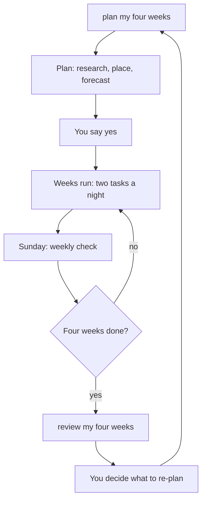

# Plan your weeks

Growth plans in four-week blocks, with a short check each Sunday. This guide explains the cycle and the limits it keeps.

## The cycle

| Step | Say | What happens |
|---|---|---|
| Plan | `plan my four weeks` | Claude researches your top gaps, decomposes them into tasks, places them on nights and forecasts a date range. Nothing is saved until you say yes. |
| Weekly check | `weekly check` | A five minute look at what got done and what slipped, how dates moved, and up to three choices for you. |
| Review | `review my four weeks` | A look back: did the work move a skill, are the gaps still the right ones, what to plan next. It suggests. You decide. |
| Why | `why this task` | Explains one task: its sources, why it is on this night, which goal it serves. Changes nothing. |

## The limits it keeps

- Two tasks a night, at most 60 minutes a night.
- Ten percent slack in the week.
- One rest night.
- A task is 15 to 60 minutes.
- Every night has one skill task and one reach task.
- Your pace sets the number of evenings: lighter 3, steady 5, push 6.
- Salary is a wish and never a hard demand.

The review is suggested, never run on its own.

## What a `plan` run does

A run has 15 steps, 0 to 14.

| Steps | What happens |
|---|---|
| 0 | Preflight: the brief, the trust check, the plan check, the lock and any partial run to resume. |
| 1 to 3 | Derive demands from your profile, ratings and proof. Refresh anything stale. Order the gaps by the stated rule. |
| 4 to 6 | Research each gap, compare two or three paths, break the work into tasks of 15 to 60 minutes. |
| 7 to 9 | Place tasks on nights, match each to a demand, forecast the date as a range with a basis. |
| 10 to 11 | An advisor reviews the diff. A different agent re-checks at least 20 percent of the citations. |
| 12 | Proposes the diff, in at most ten rows, then asks "apply?". |
| 13 to 14 | Writes the plan, runs the checks and records a changelog line. |

Claude caps each run: 48 searches, 40 fetches plus 12 for verification, 10 Sonnet subagents, 20 Haiku lookups, 2 advisor calls and 45 minutes. A cap stops the run as `partial` with a resume token. It is never raised silently.

## Research standards

Every claim in the plan is a research item with a URL, a name, a retrieval date, a published date or none, a verbatim excerpt of 25 words or fewer, a tier and a confidence. The URL must resolve the same day. Conflicts show both sides. Unsourced claims are marked "unsourced" or "my estimate".

## When a week slips

Claude always names what it does with a slipped task: carry it, compress it or drop it, with the reason. If the carry is over 25 percent of next week's capacity, it names what to compress or drop. A dropped task keeps its entry, and its demand shows as uncovered. After two slipped weeks in a row, it proposes `pace lighter` or a shorter horizon. There are no streaks and no penalties.

## Forecasts

A date is a range with a basis and a confidence. "Ready around X, range Y to Z." A late forecast is reported as late. Claude does not move it to today. If a gap has no tasks, there is no date, and it says why.

## Change the plan

- `change my plan` asks what you want, shows what would change, and waits for your yes.
- `plan lighter` or "make this week lighter" reshapes the week.
- `pace lighter`, `pace steady` and `pace push` set your evenings.
- `task move`, `task drop` and `task add` change one task.
- `goal` and `target` change where you are aiming, and re-plan around it.
- `undo` puts the files back.

## Check the plan yourself

Run these in `app/`. They only read.

| Command | What it tells you |
|---|---|
| `node scripts/plan-check.mjs` | The 23 plan checks. Exit code 1 only on a failure. |
| `node scripts/plan-forecast.mjs` | The date range, its confidence and what it depends on. |
| `node scripts/rebalance-week.mjs` | How this week would lay out under your limits. |
| `node scripts/plan-status.mjs` | A JSON summary: has a plan, weeks done, review due. |

See [Scripts](../reference/scripts.md) for all of them.

Next: [The Journal](../app/journal.md) feeds the evidence that moves your plan.
