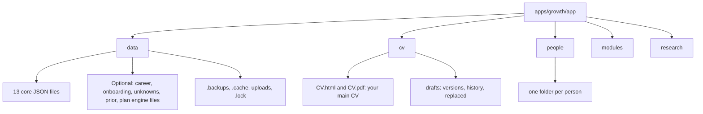

# Data files

Everything Growth remembers is a plain file in a folder on your computer. This page lists each one. The shapes are defined in `app/lib/types.ts` and checked by `app/lib/validate.mjs`.

All of these folders are git-ignored: `app/data`, `app/cv`, `app/people` and `app/research`.

## Folder map

## app/data: the 13 core files

`install.mjs` creates these from `blank-data/`, or from `demo-data/` with `--demo`. The app and the scripts need all 13 to exist.

| File | Holds | Who writes it |
|---|---|---|
| `profile.json` | Your goal (the north star), positioning, constraints, root causes, beliefs under test, intake questions and answers, pace, the person model, and add-on records (`modules`). | You in the app, and Claude. |
| `rubric.json` | The level definitions for each competency, 1 junior to 4 lead. | Claude, in the research round of onboarding. Read only otherwise. |
| `skills.json` | For each competency: level, target, confidence, source and a history of changes. | Claude, only with a history entry. |
| `evidence.json` | An append-only log of things that happened: shipped work, feedback, market results, notes and Claude's reviews. Each entry has a type and a date. | You (the journal), Claude (reviews). |
| `week.json` | This week's tasks, with `track` (`skill` or `reach`), day, minutes, steps, artifact, `where` (`phone` or `desk`) and any feedback. | Claude plans it. You change status. |
| `queue.json` | Requests from the app to Claude, with a status and a reply. See [How it fits together](../concepts/how-it-fits-together.md#the-queue-loop). | The app adds. Claude closes. |
| `bets.json` | One active bet per track (skill and reach), with a focus, a review date and a result. | Claude. |
| `learning.json` | Research briefs, each with three to six points and checked sources. | Claude. |
| `tests.json` | Scenario tests and their scores. | Claude writes and scores. You answer. |
| `proof.json` | What a recruiter or interviewer can see: CV, case studies, profile items, with a status. | Claude updates from evidence. |
| `reach.json` | The funnel per batch, applications with their stage, and recognition counters. Market facts only. | You and Claude. |
| `library.json` | This week's picks, saved links, gaps, the left-out list and trinkets. | Claude weekly. You keep, skip or finish a pick. |
| `notnow.json` | Things you are deliberately not doing, with a reason and a date to revisit. | You and Claude. |

## app/data: optional files

These appear when you use the feature that needs them.

| File | Holds |
|---|---|
| `career.json` | CV versions and case studies. The honesty check guards it. Written only through `cv-act.mjs`. |
| `onboarding.json` | Interview state: round, answers, consent records, summaries, skips and boundaries. |
| `unknowns.json` | Every "I don't know" with how to find out, a due date and a draft task. |
| `prior.json` | A read-only archive of what you had before a reset. |
| `demands.json` | What the plan must meet, derived from your profile, ratings and proof. |
| `plan.json` | Four weeks of placed tasks, with the inputs and gap order. |
| `research.json` | Every citation the plan rests on: URL, tier, excerpt, confidence. |
| `sources.json` | The best places to learn each thing, ranked. |
| `runs.json` | A log of each run, with what it updated and what it left. |
| `reviews.json` | The four-week reviews. |

## app/data: hidden items

| Item | What it is |
|---|---|
| `.backups/` | The previous version of every file, the last 40 per file. It is never deleted. Set `GROWTH_BACKUP_DIR` to keep backups elsewhere. |
| `.cache/` | Scratch for a plan run, and the cache of what the last brief saw. |
| `.lock` | Present while Claude or the app is updating your data. Holds who started it and when. |
| `uploads/` | Files you attach when you hand work in, up to 15 MB each. |

## app/cv

| Path | Holds |
|---|---|
| `CV.html`, `CV.pdf` | Your main CV. Change only through `cv-promote`. |
| `.denylist.json` | Terms (and optional patterns) from your career notes that must never appear in a CV. Local only. Claude never prints it. |
| `drafts/CV_vN.html` | The rendered draft of each CV version. |
| `drafts/CV_vN.pdf` | The PDF export of a version. |
| `drafts/_history/` | Earlier copies of a draft, stamped with the date. |
| `drafts/_replaced/<date>/` | The CV file that a promotion replaced. |

## app/modules

| Path | Holds |
|---|---|
| `<id>/skill/SKILL.md` | An add-on, saved exactly as given. |
| `<id>/notes.md` | Claude's note about it. |
| `ledger.json` | What the app can already do on its own. |
| `_examples/` | Two safe skill files to try the add flow with. |
| `_scratch/` | A temporary working copy. Emptied after use. |

## app/people/`<id>`

One folder per G mini person. See [The g-mini skill](../skills/g-mini.md).

| Path | Holds |
|---|---|
| `profile.json` | Name, id, consent, targets, level, market, deadline, hours a week, currency, confidential terms, the guard token and whether the person is frozen. |
| `onboarding.json` | Their interview answers and the facts saved from their CV and LinkedIn text. Each answer has a status (`answered`, `unknown` or `skipped`) and a `private` flag. |
| `inputs/` | Their CV and LinkedIn text, saved byte for byte, with an `_index.json`. |
| `research.json` | Sourced research items: roles, patterns, interviews, salary, market and reading. |
| `gap.json` | The gap map rows. |
| `plan.json` | The dated plan, in weeks, with a ready range. |
| `report/<date>/` | `report.html` and `report.pdf`. A new dated folder for each build. |
| `.undo/` | Snapshots, so `undo` can put back the last save. |
| `.lock` | Present during a write. |

`people/_archive/` holds a full copy of any person who withdrew consent or was deleted.

## Skill folders

These are outside the app, in `~/.claude/skills/`.

| File | Holds |
|---|---|
| `growth/config.json` | `growthRoot`, `coachSkill` and `dossier`. |
| `g-mini/config.json` | `appRoot` and `peopleDir`. |

## Your career notes file

This is your own file, and not part of the repo. Set `GROWTH_DOSSIER` to its path. It is a markdown file whose sections the CV check quotes by number. Section 3.9 lists work that is not yours. Section 3.10 lists confidential items. Lines can carry evidence tags such as `[Fact]`, `[Shown]`, `[Reported]`, `[Requested]`, `[Proposed]`, `[Analysis]` and `[Unknown]`. A claim whose every quote is tagged only `[Proposed]`, `[Requested]`, `[Reported]` or `[Analysis]` cannot say finished work.

## Dates and ids

- Dates are local, `YYYY-MM-DD`.
- Evidence entries are `ev-NNN`. Queue items are `Q-NNN`. Briefs are `L-NNN`. Tests are `T-NNN`. Skill tasks are `S-NN` and reach tasks are `R-NN`. Picks are `P-NNN`. Gaps are `G-NN`.
- CV versions are `v1`, `v2` and so on.

Next: [FAQ](faq.md).
