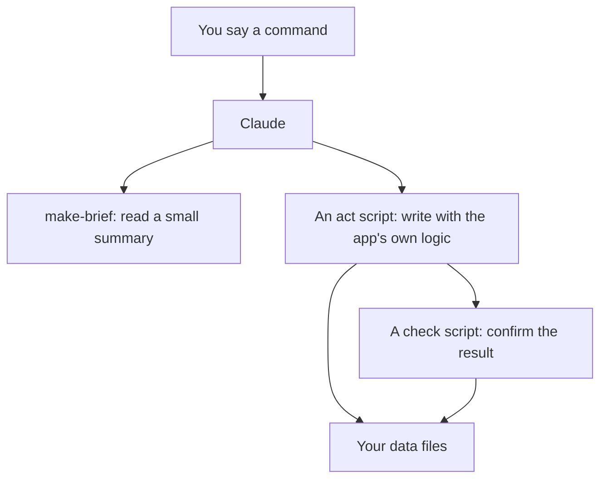

# Scripts

The scripts live in `app/scripts/`. Claude runs most of them for you. You can run them yourself from `app/`. They are the way every write happens, so the app and Claude use the same logic.

Run them with `node scripts/<name>.mjs`. Where an npm shortcut exists, it is shown.


Claude never puts your words on a command line. It writes an action to a JSON file and passes `--file <path>`. That keeps quotes and special characters from breaking a write.


## Which script does what

## Common flags

| Flag | Meaning |
|---|---|
| `--file <path>` | Read the action or actions from a JSON file. One action, or a list applied in order. |
| `--data-dir <dir>` | Use another folder instead of `app/data`, for a test copy. |
| `--dry-run` | Run everything, save nothing. |
| `--json` | Print the result as JSON. |

Writers take `data/.lock` exclusively, snapshot first, validate, and save nothing if anything is refused.

## Reading and checking your data

| Script | What it does |
|---|---|
| `make-brief.mjs <command>` | Builds a small, honest summary of the data for one command: `answer`, `library`, `review`, `plan`, `cv`, `journal`, `person`, `status` or `onboarding`. It lists what is stale, unsourced or low confidence. It is read only, except for a cache of what the last run saw. The `onboarding` command and `--no-write` never write. Also at `/api/brief?command=...`. |
| `check-data.mjs` (`npm run check`) | Checks everything in `data/` after any write. Exit code 1 means the app may break or mislead you. It also checks CV html files and the honesty check, and warns on tone. |
| `trust-check.mjs` (`npm run trust`) | Twelve trust checks over your data. Read only. Exit 1 only on a failure. |
| `attention-check.mjs` | Six checks on the attention inbox logic. |
| `forecast-check.mjs` | Checks the forecast logic. |
| `ui-consistency-check.mjs` | Checks the words the UI says more than once. |

The twelve trust checks are `ref-integrity`, `rating-age`, `rating-evidence-floor`, `no-ai-only-support`, `numbers-have-source`, `evidence-date-quality`, `gap-estimate-basis`, `pick-freshness`, `picks-scored`, `ready-by-reproduce`, `trace-completeness` and `person-provenance`.

## CV and case studies

See [Build an honest CV](../guides/build-an-honest-cv.md).

| Script | What it does |
|---|---|
| `cv-act.mjs` (`npm run cv:act`) | Applies CV and case study actions to `data/career.json` with the app's logic: shape rules, the honesty check, and the HTML render. Takes the lock, makes the one snapshot, saves nothing if anything is refused. Writes `cv/drafts/<name>.html`, keeping the old one in `cv/drafts/_history`. Actions: `cv.version.add`, `cv.section.set`, `cv.fill`, `cv.current`, `cv.ats.set`, `case.set`, `case.remove` and `evidence.note`. |
| `cv-check.mjs` (`npm run cv:check`) | The honesty check on every CV version and case study. Prints first, then records today's result in each version's `checks.honesty`. `--version vN`, `--case <id>`, `--json`, `--no-write`. |
| `cv-export.mjs` (`npm run cv:export`) | Saves one CV version as a PDF with headless Edge, at `cv/drafts/CV_vN.pdf`. Refuses when the honesty check fails. Exports only with `--draft` when facts are still needed, and stamps the footer. Never touches `cv/CV.html` or `CV.pdf`. `--edge <path>` points at Edge. |
| `cv-promote.mjs` (`npm run cv:promote`) | Makes one version your main CV: `cv/CV.html` and `cv/CV.pdf`. The only way those two files change. Needs a passing honesty check, no facts still needed and a PDF newer than the last change. Backs up the old ones to `cv/drafts/_replaced/<date>/`. `--undo` restores them. |

Flags shared by the CV scripts: `--dossier <path>` and `--denylist <path>` point at your career notes and deny-list. The environment variable `GROWTH_DOSSIER` does the same.

## Onboarding

See [Your first run](../getting-started/first-run.md).

| Script | What it does |
|---|---|
| `onboarding-act.mjs` | Applies onboarding actions: `onboard.answer`, `onboard.confirm`, `onboard.skip`, `onboard.consent`, `onboard.round`, `onboard.research`, `onboard.rubric`, `onboard.map`, `onboard.contradiction`, `onboard.rating`, `onboard.pause`, `onboard.forget`, `onboard.boundary`, `onboard.skip_round`, `onboard.redact`, `unknown.add`, `unknown.resolve` and `onboard.reset`. It validates the value, works out confidence from evidence, fills the field each answer belongs to, and keeps the unknowns ledger and contradictions. Also reads units, words and currency in number answers and echoes what it heard. |
| `onboarding-check.mjs` (`npm run onboarding:check`) | Completeness and integrity. Prints `PASS`, `WARN` or `FAIL` lines. `--json`, `--derive` (also prints what would feed the plan). With no onboarding it says "not started". |
| `onboarding-status.mjs` | Prints the status as one JSON object. Used by `/api/onboarding-status`. Read only. |
| `onboarding-reset.mjs` | `plan` is a dry run that prints a token and the phrase. `apply --token T --phrase "..."` backs up with a checksum manifest, archives to `data/prior.json`, blanks, validates and restores by itself on any failure. `restore --from <backup>` puts files back byte for byte. `--force-new`, `--different-person`, `--json`. |
| `onboarding-lint.mjs` (`npm run onboarding:lint`) | Lints the question bank, or one wording with `--text` and `--name`. |

## G mini

See [The g-mini skill](../skills/g-mini.md).

| Script | What it does |
|---|---|
| `mini-act.mjs` | The one way G mini data is written. Every call that touches a person needs `--person <id>` and `--guard <token>`. `--list` shows everyone. `--brief [--n 3] [--redo]` shows the stage, the next questions and what to do next. `--validate` checks a person's files. `--people-dir <dir>` uses another folder. |
| `mini-report.mjs` | Builds `people/<id>/report/<date>/report.html` and `report.pdf` with headless Edge. Refuses when consent is missing, the honesty check fails or a private answer would be printed. Gaps become `[NEEDS: ...]`. `--no-pdf` skips the PDF. After the report the person is frozen. |

## The plan engine

See [Plan your weeks](../guides/plan-your-weeks.md). All of these only read and print.

| Script | What it does |
|---|---|
| `demands.mjs` | Derives the demands from your profile, ratings and proof. `--out` writes a scratch file for a plan run to copy in. |
| `place-tasks.mjs` | Places tasks onto nights with the deterministic rules. `--weeks 4`, `--rest Sun`, `--from Mon`. |
| `rebalance-week.mjs` | A dry run of how this week would lay out under your limits: 2 tasks and 60 minutes a night, 5 evenings, 10 percent slack, one rest night. |
| `plan-forecast.mjs` | The date range, confidence and what it depends on. `--pace lighter/steady/push`, `--per-week N`. |
| `plan-check.mjs` | The 23 plan checks. `--week`, `--preflight`, `--json`. With no plan it says "no plan yet". |
| `plan-status.mjs` | JSON summary: `has_plan`, `horizon`, `weeks_done`, `review_due`, `stale_research_count`, `next_action`. Used by `/api/plan-status`. |
| `verify-excerpts.mjs` | Checks research excerpts against page text that Claude saved. Fetches nothing, writes nothing. |
| `run-log.mjs` | Works out what a run left undone: stale, unsourced and failing items minus what it touched. `--record` prints a draft log record. |
| `domain-gap.mjs` (`npm run domain:gap`) | Prints the distance from A to B without writing anything: where you are now and where you want to be, for the launch roles. |

The 23 plan checks cover, among others: every open gap has planned tasks, every task meets a demand, research is present and fresh, excerpts follow the rules, a sample of citations is verified, day and week load, dependencies, the horizon is full, the forecast reproduces, both tracks on a night, task size, demands are current, rating moves have history and examples are marked as illustrations.

## Add-ons

| Script | What it does |
|---|---|
| `module-scratch.mjs <id>` | Makes a safe working copy of an add-on in `modules/_scratch/<id>/`. First it checks the sha1 of every skill file against its recorded one. One mismatch and nothing is written. `--clean` empties the scratch folder. |

## Phone relay

| Script | What it does |
|---|---|
| `lan-relay.mjs` (`npm run lan`) | Listens on your Wi-Fi at port 4322 and forwards to the app on 127.0.0.1:4321. Every forwarded request is marked, so the app asks the device to pair. |

## Test and fixture scripts

These test Growth itself and run on temporary copies, never on your live data.

| Script | What it does |
|---|---|
| `onboarding-fixtures.mjs`, `onboarding-fixtures-4.mjs`, `-5.mjs`, `-6.mjs` | Fixtures for the onboarding system. |
| `onboarding-sim.mjs`, `onboarding-sim-3.mjs` | Drive invented people through the real scripts, R0 to R5. |
| `onboarding-regression.mjs` | Ten people through the real scripts, six end to end and four structural. |
| `onboarding-store-test.mjs` (`npm run test:store`) | Drives the app's real store against temporary copies. |
| `onboarding-personas.mjs`, `onboarding-transport.mjs` | The invented people and how actions are sent. |
| `domains-check.mjs`, `domains-flow-check.mjs`, `domains-regression.mjs` | Checks for the domain graph and flow. |
| `domains-fixtures.mjs`, `domains-personas.mjs` | Fixtures and personas for them. |
| `plan-check-fixtures.mjs` | In-memory fixtures for the plan checks. |
| `make-skeleton-fixture.mjs` | Writes the blank state an onboarding reset leaves, for a design page. |

## Helper modules

Files that start with an underscore are shared helpers and are not run directly: `_data.mjs` (read the live data), `_no-people.mjs` (refuses any data folder inside `people/`, so Growth and G mini never mix), `_plan.mjs` (the plan checks) and `_trust.mjs` (the trust checks).

## npm shortcuts

| Run | Does |
|---|---|
| `npm run dev` | Starts the app on port 4321, bound to 127.0.0.1. |
| `npm run lan` | Starts the phone relay. |
| `npm run build`, `npm start` | Production build and start. |
| `npm run check` | `check-data.mjs`. |
| `npm run verify` | Type-checks the app, then runs the data check. |
| `npm run trust` | `trust-check.mjs`. |
| `npm run brief` | `make-brief.mjs`. |
| `npm run cv:check`, `cv:act`, `cv:export`, `cv:promote` | The CV scripts. |
| `npm run onboarding:lint`, `onboarding:check`, `onboarding:fixtures`, `onboarding:sim`, `onboarding:regression`, `test:store` | Onboarding checks and tests. |
| `npm run domains:check`, `domains:flow`, `domains:regression`, `domain:gap` | The domain graph. |

Tests that embedded one person's real career notes were removed from the public copy. The remaining checks use synthetic data.
