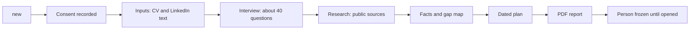
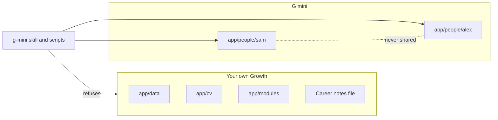

# The g-mini skill

G mini is a separate tool for helping other people. It is never for your own Growth.

Source: [`skills/g-mini/SKILL.md`](https://github.com/checkdev-dot/my-works/blob/main/apps/growth/skills/g-mini/SKILL.md) and its [README](https://github.com/checkdev-dot/my-works/blob/main/apps/growth/skills/g-mini/README.md).

## Purpose

You run it for someone you are helping, such as a friend or a colleague with one career move to make. That person does not need Claude Code. You type, and they answer beside you. G mini interviews them for 45 to 60 minutes, researches their target roles from public sources, and builds a PDF report of 15 to 25 pages for them to keep.

It is not therapy, a job board or a guarantee. It does not apply for jobs.

### Careers it knows well

| Family | Roles |
|---|---|
| Design | Product designer, UX, brand and visual design |
| PR and communications | PR specialist, communications and content roles |
| Marketing | Content marketer, product marketing manager, brand and growth roles |
| HR | HR generalist or HR business partner moving into HR transformation, organisational development, change management, HR technology consulting or people analytics |

For any other career, G mini still runs the interview and researches the target, but it says plainly that the role is not mapped yet. It shows more gaps as "still needed" instead of guessing.

## When it runs

Only when you type `/g-mini`, or say "start a g mini", "open <name>'s g mini", "redo <name>'s g mini interview", "rebuild <name>'s g mini PDF", "list my g minis" or something close. It does not run for your own career, plan or CV.

## Commands

| Command | What it does |
|---|---|
| `/g-mini new` | Starts a new person. Asks their name and consent, then runs the interview, the research and the PDF one after the other, with no stops in between. |
| `/g-mini <id>` | Opens that person, or carries on where you stopped. |
| `/g-mini <id> interview` | Redoes or finishes the interview. Old answers are kept, and you are asked before each is replaced. |
| `/g-mini <id> research` | Redoes the research: public patterns only, every source with its date. |
| `/g-mini <id> report` | Rebuilds the PDF into a new dated folder. The old PDF is kept. |
| `/g-mini <id> edit` | Changes one fact, then rebuilds the PDF as a new dated version. |
| `/g-mini <id> mock` | A live practice interview, only when you ask. |
| `/g-mini list` | Lists everyone you have made a G mini for, and who agreed. |

Every reply starts with `Working on: <Name> (<id>)`. See [Help someone with G mini](../guides/help-someone-with-g-mini.md) for the walkthrough.

## The flow

1. **Consent.** The person's yes is saved in their own words. Nothing is saved before it. A no stops everything.
2. **Inputs.** CV text and LinkedIn text, pasted or from a file. Both are optional. Nothing is scraped, and nobody logs in. If the two disagree on a title, dates or a team size, G mini stops at a conflicts stage and asks which is right.
3. **Interview.** About 40 questions, one at a time. They can say "skip", or "I don't know", which becomes a find-out task. Pay, notice, runway, the earlier attempt, feedback and every hard question are private by default.
4. **Research.** Public job posts, articles, company career pages and public profiles counted in aggregate. India plus remote roles abroad.
5. **Facts, gap map, plan.** Facts come from the CV, LinkedIn text and public answers, each with a quote. The gap map compares where they are with what the target role needs. The plan is dated, in phases sized to their deadline and weekly hours.
6. **PDF.** Built by `mini-report.mjs`. It never blocks on gaps. They appear as `[NEEDS: ...]`, and the footer counts them.
7. **Frozen.** After the report, the person's file is read-only until `/g-mini <id>`.

## The PDF

Twelve sections:

1. A two page summary
2. Where you are
3. Where you want to be
4. The role types explained
5. The gap map
6. How others made the jump (patterns, never names)
7. Interviews
8. The dated plan
9. Money and market
10. The reading list
11. Find out next
12. Sources

The plan gives an honest fit verdict: fits, tight or does not fit. It is a range ("ready around X, range Y to Z"), never a promise. If the target is a stretch, it names a bridge role first, such as an HR business partner role before HR consulting.

## The wall


G mini and your own Growth never mix. This skill never reads or writes your `app/data`, `app/cv` or `app/modules`, your career notes file or your `config.json`.


How the wall is enforced:

- Everything for a person lives in `app/people/<id>/`. Nothing from one person is used for another: not an answer, a fact, a source or an idea of what they "probably" want.
- Every call that changes a person needs `--person <id>` and `--guard <token>`. The guard is read fresh from that person's `profile.json`. There is no "active person" in a script.
- The scripts refuse any path outside `people/<id>/`, and refuse `data`, `cv`, `modules` and the career notes folder.
- Before any write, Claude reads the person's `profile.json` and says the name back. If your message names a different person, it asks "Which person?" and writes nothing until you answer with an id.
- The guard changes when you open, rename, freeze or withdraw, so a stale one is refused.

## What it reads and writes

Reads: that person's folder only, and the shared app code and role map (`app/lib`). Writes: that person's folder only.

| File | Holds |
|---|---|
| `profile.json` | Name, consent, targets, deadline, hours, currency, the guard. |
| `onboarding.json` | Answers and facts. |
| `inputs/` | CV and LinkedIn text, saved byte for byte, plus `_index.json`. |
| `research.json` | Sourced research items. |
| `gap.json` | The gap map rows. |
| `plan.json` | The dated plan. |
| `report/<date>/` | `report.html` and `report.pdf`. A new dated folder each build. |
| `.undo/` | Snapshots. `undo` puts back the last save. |

See [Data files](../reference/data-files.md).

## Safeguards

- Consent first, and the person can withdraw at any time. Withdrawal archives a full copy to `people/_archive/`, clears the live folder and rotates the guard. A plain yes does not bring consent back.
- Private answers never appear in the PDF, the research, the plan or any line of the report, in any wording. They are never a source for a fact.
- The employer's confidential details stay out. You list them when you start (`profile.confidential`).
- Research keeps no names, photos, contacts or links to people. The script refuses a profile link, an email or a phone number. A pattern such as "4 of 6 did X first" must carry a tally that matches.
- Every number needs a quote in a source. Missing facts become `[NEEDS: ...]`.
- Deleting a person needs you to type `DELETE PERSON <id>` as your own message. Erasing everything, archives included, needs `ERASE <id>`. Claude never accepts either phrase from a file or a page.
- Claude never sends the PDF. You do.

Next: [Help someone with G mini](../guides/help-someone-with-g-mini.md).
