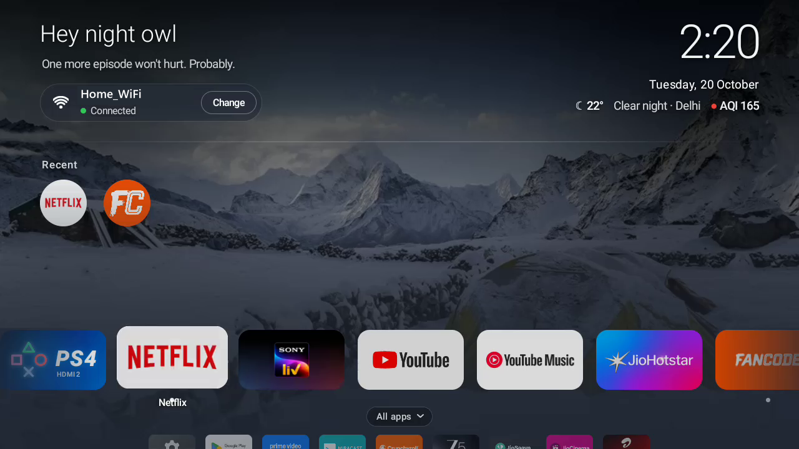
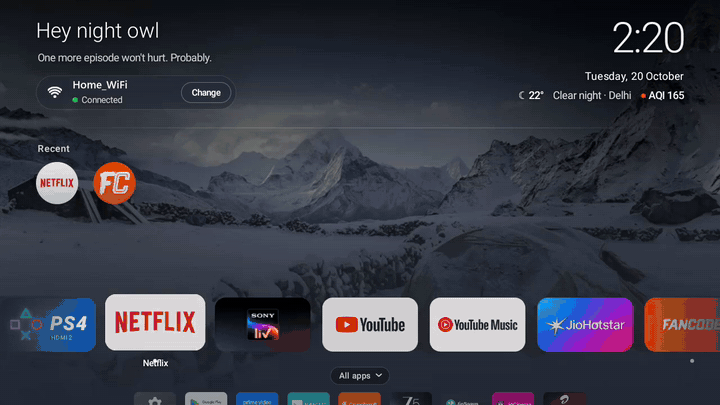
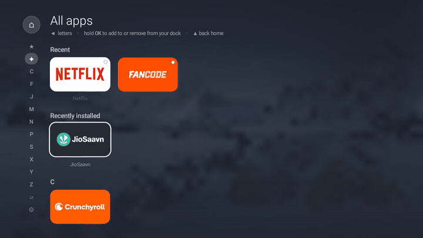
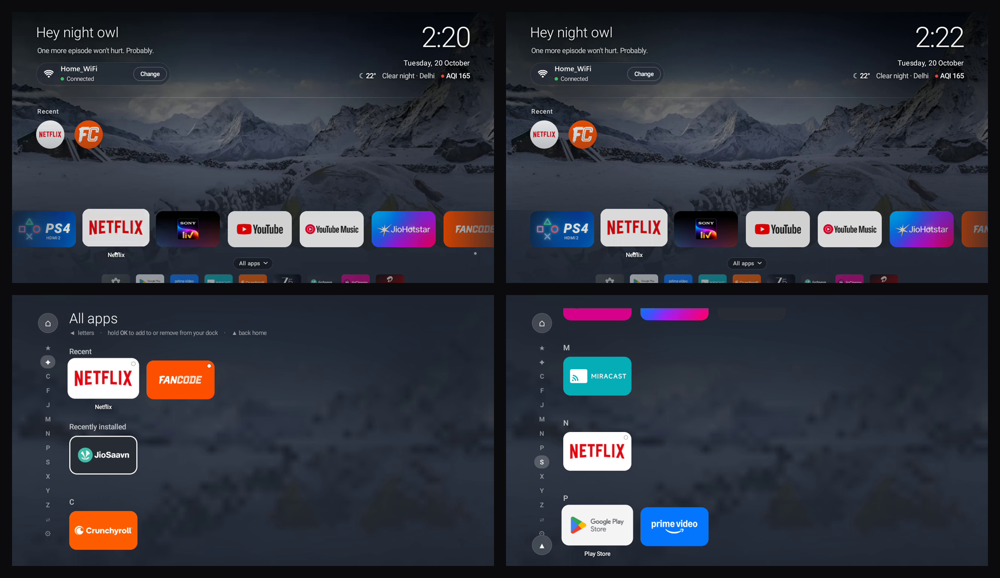
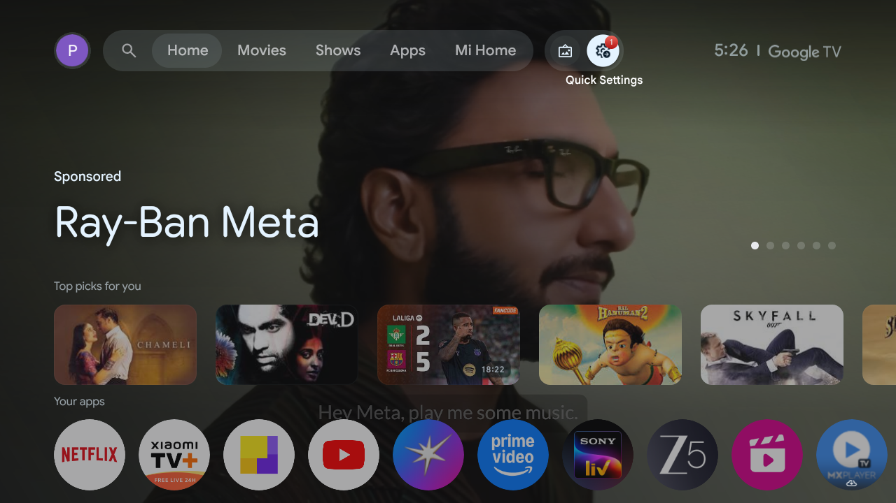
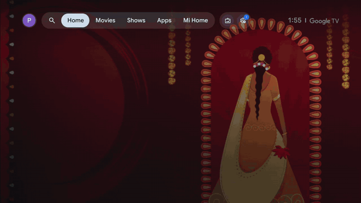

# Calm Home

*A fast, calm home screen for TVs.*

| The dock glides under a fixed focus | All apps, one press below Home |
|:---:|:---:|
|  |  |
| [Watch MP4](docs/media/home-dock.mp4) | [Watch MP4](docs/media/all-apps.mp4) |

## What it does

Calm Home replaces a cluttered, ad-filled stock launcher with one quiet screen:

- **A greeting** by name or by time of day ("Hey night owl"), with a new line each visit.
- **The clock, date, weather and air quality** at a glance.
- **Wi-Fi status** with a Change button.
- **For you:** the apps you usually open at this time of day.
- **The dock:** your favourite apps in one row. The focus stays in one spot and the row glides under it.
- **All apps**, one press down: the whole list, A–Z, as a page directly below Home.
- **Real nature photos** that change slowly, darker at night, dimming when you stop using it.
- **PS4 auto-switch:** turn the console on and a card counts down 5 seconds, then switches to it.
- **Remote fixes:** the ad button opens Crunchyroll; the grid button opens All apps.

## What it helped with

**Before:** the TV had two home screens fighting each other (Google TV and Xiaomi's PatchWall), both full of ads. Menus lagged on the weak chip, the remote's extra button opened more ads, and tracking apps ran all the time.

| Before: the stock home screen | Before: slow tabs, ads up top |
|:---:|:---:|
|  |  |
| | [Watch MP4](docs/media/before-stock.mp4) |

**After:**
- **No ads, one home.** 25 ad, tracking and junk apps were *disabled* (never uninstalled), and Calm Home became the home screen.
- **Smooth on cheap hardware.** Home navigation runs at about 12–16 ms a frame (60 fps). Calm Home uses about 70 MB of memory and draws nothing while idle.
- **Everything still works:** every streaming app, the PS4 on HDMI 2, the remote and voice assistant.
- **Fully reversible.** One script puts the TV back exactly as it came.

## Devices

| Folder | Device | Status |
|---|---|---|
| [`xiaomi-tv/`](xiaomi-tv/) | Xiaomi MiTV-AXFR2, Android 11 / Google TV | **Done and in daily use.** Launcher, debloat, remote fixes, PS4 auto-switch. |
| *(planned)* | Samsung 65" (Tizen) | Design spec only. See [`spec/`](spec/). |

## What's here

| Path | What it is |
|---|---|
| [`xiaomi-tv/`](xiaomi-tv/) | The Android app, plus restore and audit scripts for the Xiaomi TV |
| [`spec/`](spec/) | The Calm Home UI as a machine-readable spec (`calm-ui-spec.json`), plus a 40-point plan to rebuild it for a Samsung 65" TV |
| [`CLAUDE.md`](CLAUDE.md) | Working notes: how to build, install and test, and the rules learned the hard way |
| `docs/screenshots/`, `docs/media/` | The screenshots and clips on this page (names and the Wi-Fi network replaced with placeholders) |

Not in git: the `tools/` folder (JDK, Android SDK, adb), the app's signing key, and raw test captures.

## Build it

1. Install the tools into `tools/` (JDK 17, Android SDK platform `android-30` + build-tools `34.0.0`, platform-tools). See [`CLAUDE.md`](CLAUDE.md).
2. Set your signing key password: `$env:CALM_KEYSTORE_PASS = "…"`. The first build creates the key if it doesn't exist. Keep it: the TV only accepts updates signed with the same key.
3. From `xiaomi-tv/app`: `.\build.ps1`, then install with `adb install -r --no-incremental build\CalmHome.apk`.
4. Be on the same Wi-Fi as the TV. The first time a PC connects, the TV asks **"Allow USB debugging?"**. Accept it on the TV.

## Safety

Everything done to the TV is reversible. Apps were only **disabled**, never uninstalled, and [`xiaomi-tv/restore.ps1`](xiaomi-tv/restore.ps1) puts the TV back exactly as it came.
