# Font engine

*Working name.* Shape a letter until it looks right, and the app finds the real free fonts closest to it. The search query is a letter you made, not a category you picked from a list.

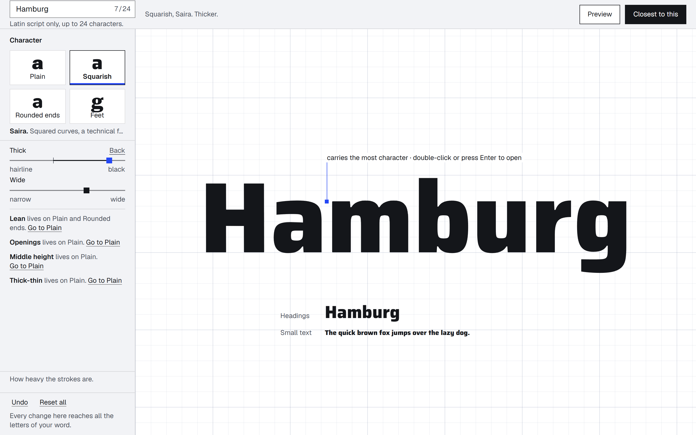

## How it works

**1. Shape a word.** Type a word, or keep "Hamburg". Pick one of four starting styles: Plain, Squarish, Rounded ends or Feet. Each one is a real variable font drawn by type designers, so every setting stays a working letter. The dials change thickness, width, lean, openings, lowercase height and the difference between thick and thin strokes. Each change reaches every letter of your word.

**2. Open a letter.** Double-click any letter to zoom in. Handles sit on the letter's own edges: drag the outer edge of a stem to make it thicker, the side to make it wider. Only the dials that visibly change *this* letter are shown. A size strip underneath shows your word small, as a heading, and huge.

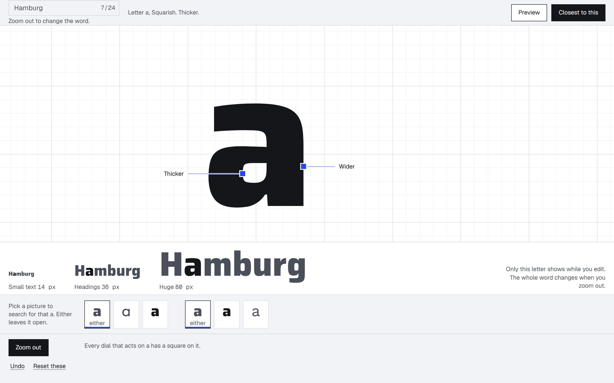

**3. Pick how the letter is built.** Thickness and width are not the whole story. A `b` can join its stem smoothly or with a notch, an `a` can have one storey or two, with a tail or without, a `t` can have a flat or cut top, a `G` can have a spur. Those choices are pictures, not words. When the starting style can draw the shape, the whole word changes to it; when it cannot, a faint outline shows what you asked for and the search looks for fonts built that way.

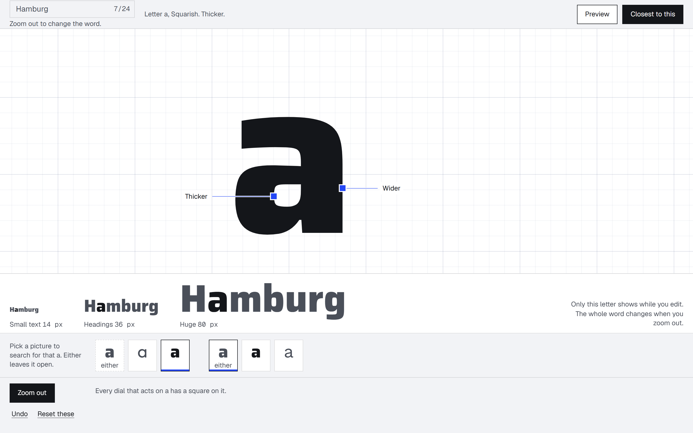

**4. Zoom out.** The whole word is now what you shaped. That reveal is the point of the zoom.

**5. Get the closest real fonts.** Each result is set in your own word, with a match percentage, what matches, what differs, and a link to get the font. "Yours" sits on top so you can compare.

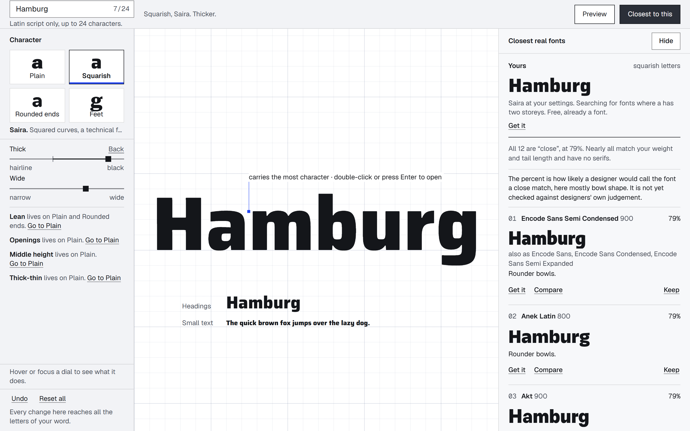

**6. Preview before you commit.** Keep two or three fonts, mark one preferred, and see them in real work rather than in a specimen. The preview is laid out as pages 7.1 to 7.7 of a brand manual: each piece flat at a stated scale, with a grey caption saying the scale, the smallest text size, which weights the font has and what the page is testing for. Press 1, 2 or 3 to swap fonts instantly in place, so nothing moves except the type. Compare shows the fonts as rivals; Pair makes the preferred font the headings and the next one the body text.

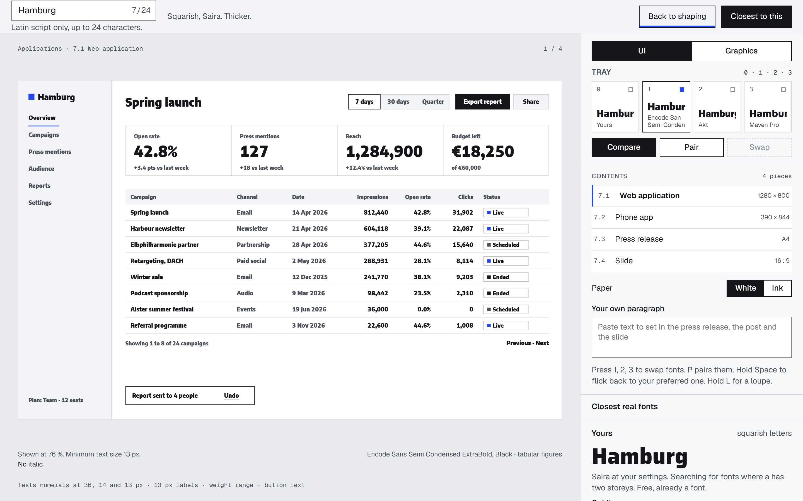

| | |
|:---:|:---:|
| 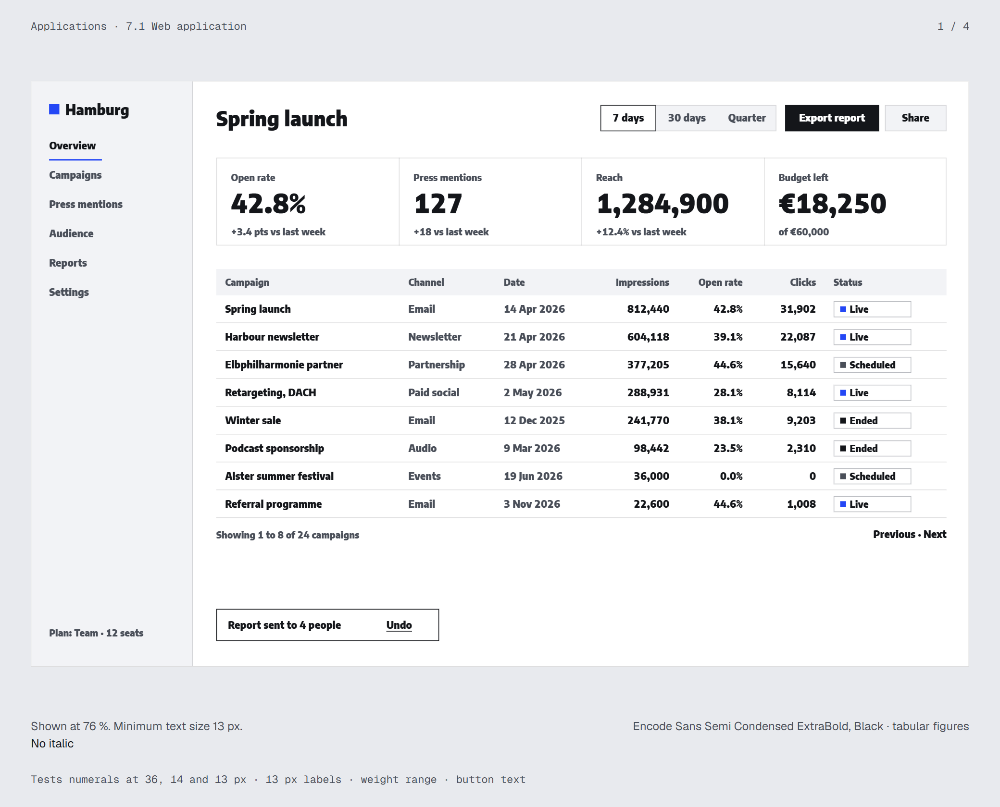 | 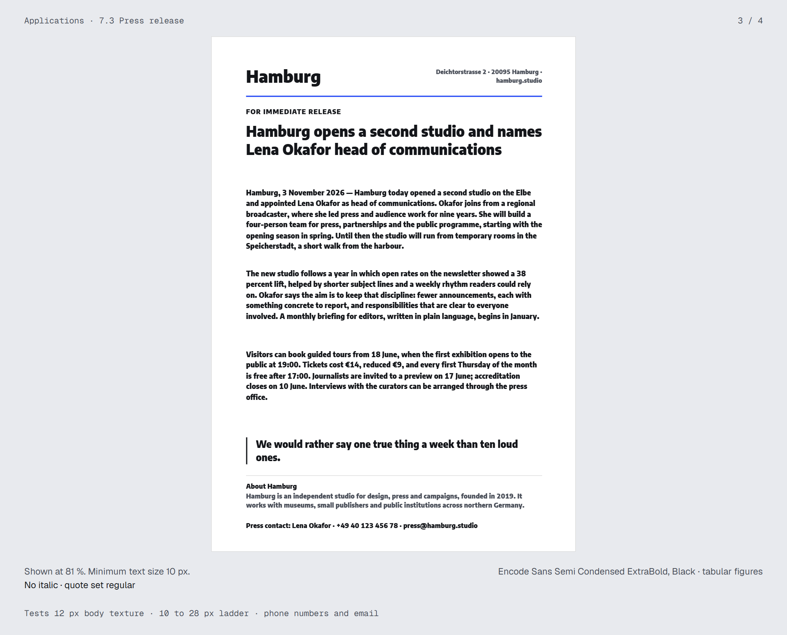 |
| 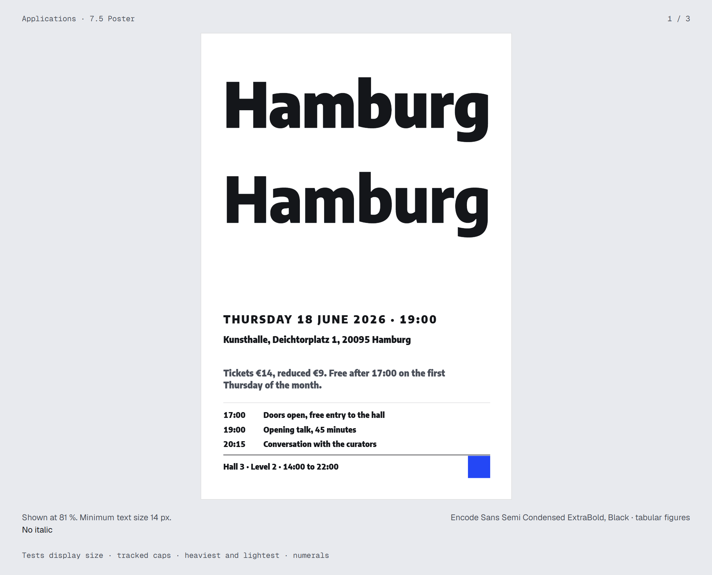 | 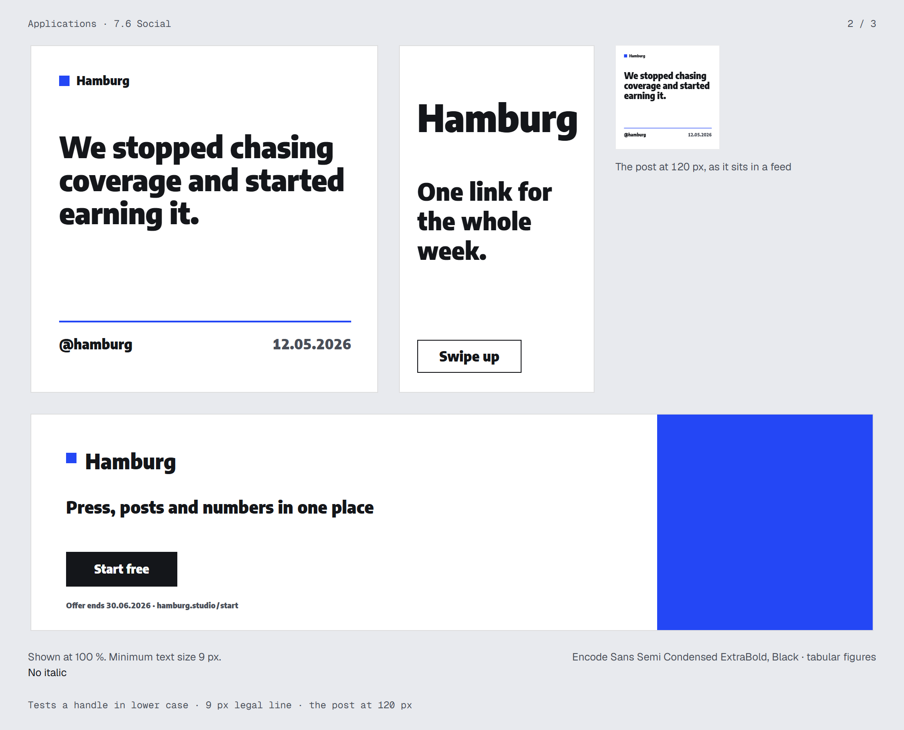 |
| 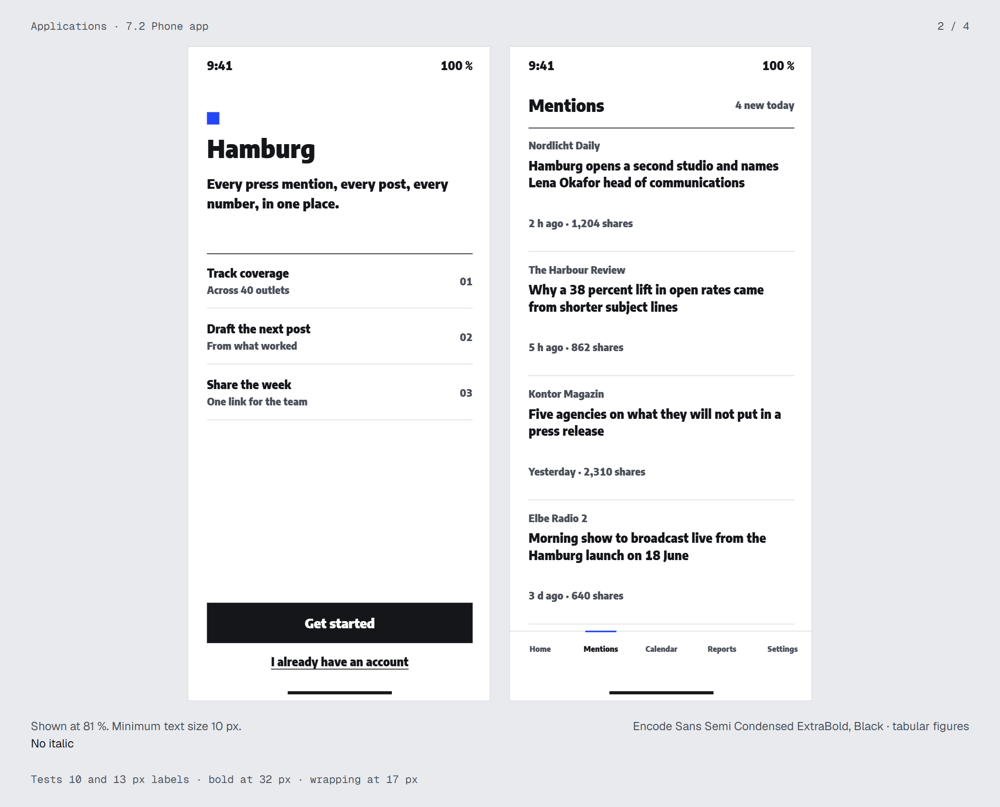 | 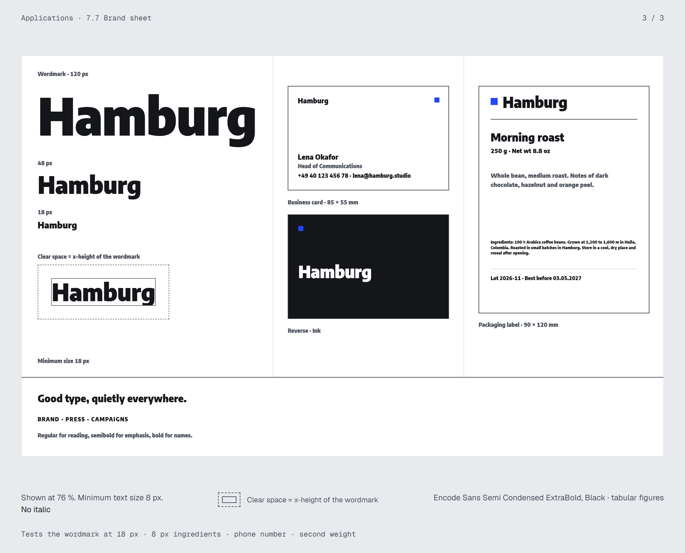 |

Seven templates in two groups. **UI:** dashboard, phone app, press release, slide. **Graphics:** poster, social posts, brand sheet. Each one is chosen to expose something a typeface has to survive: numerals at three sizes, 10 px labels, body texture, headline rhythm, a wordmark at favicon size, 8 px ingredients on a packaging label. A font that cuts off labels says so in the caption rather than failing quietly.

## The matching engine

Every font in the library is measured ahead of time, not tagged by hand.

- **1,715 families, 7,053 files**, nearly all under the SIL Open Font License, from Google Fonts via Fontsource.
- **Ten groups of measurements** per letter: weight, width, contrast, pen feel, slant, terminal shape, bowl fullness, openness, lowercase height and serifs. Letters `a e g n o H O` are compared, with capitals for capitals-only display faces.
- **Letter construction** is measured separately: `a` and `g` storeys, the `a` tail, the `b` join, the `t` top, the `l` tail, the dot shape, the `G` spur, the `R` leg, the `Q` tail, `J`, `1` and `4`. A shape you pick is a hard fact the search obeys, and a shape you leave alone never rules anything out.
- **A match percentage** calibrated against how far apart real fonts are, not a raw distance. Fonts that clearly miss rank last and show a word instead of a number.
- **Families are grouped**, so the widths of one design take one row with the rest listed as "also as", and fonts made for other writing systems are demoted when you are typing Latin.
- **About 100 ms per search** in the browser, over the whole library.

The measurements are in `public/library/index.json`. The real font files are never bundled: a result loads its font from the Fontsource CDN at the moment it is shown.

## Running it

```bash
npm install && npm run dev
```

Then open http://localhost:4330. Desktop sizes only for now.

Rebuilding the library needs the font files: `scripts/` downloads them to `./.font-cache` (set `FONT_ENGINE_CACHE` to move it), measures every file and writes the index. That takes about 75 minutes and roughly 1.4 GB of disk.

## Honest state

This is not finished. The last design review scored it 24 out of 40.

**Works:** shaping, the reveal, handles, letter-form pictures, matching, results, all seven preview templates, keyboard use throughout, no console errors at desktop sizes.

**Known problems:**
- Some letter-form pictures are drawn in a stand-in font at the wrong weight, so they read as "thinner" instead of "built differently", and the rows have no titles.
- Picking several letter shapes at once narrows the search hard, and nothing explains why the results got worse.
- Some handle leader lines cross the letter's own ink.
- Font names in the preview slots lose every "s" to a bad split, and long names are clipped.
- Pair can give the body role to a capitals-only display face.
- Heavy rounded letters are still hard to match unless the Rounded ends style is chosen.
- Kept fonts are not saved, so a reload loses them.
- No phone or tablet layout.

The full list, with how each one would be fixed, is in [`docs/`](docs): `failure-cases.md` holds every reported failure as a checkable rule, `problems-ui.md` and `problems-matching.md` hold the hunts, `letter-forms.md` holds the letter anatomy catalogue, and `controls-v4.md` is the build spec the app was made from.

## Licence

The five bundled variable fonts are under the SIL Open Font License 1.1; see [`public/fonts/README.md`](public/fonts/README.md) for each one's source and copyright.
