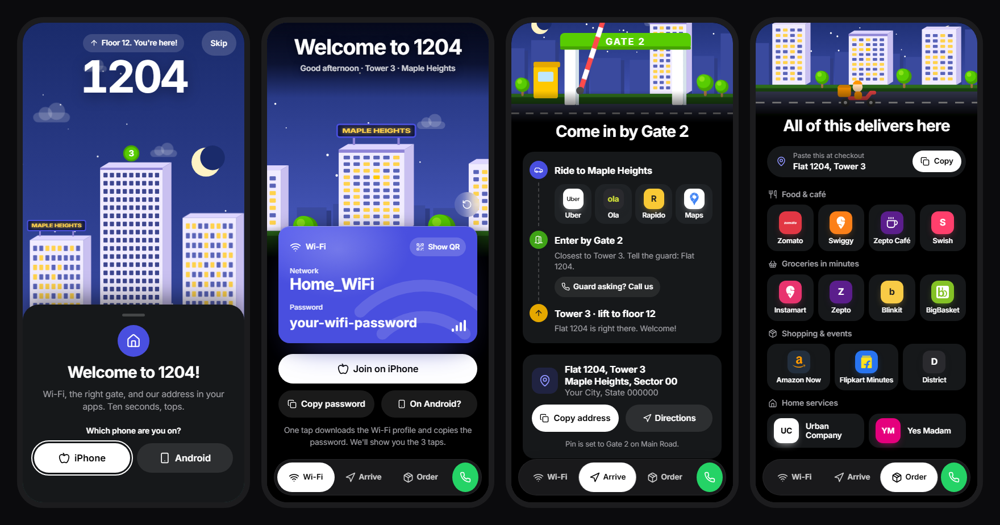
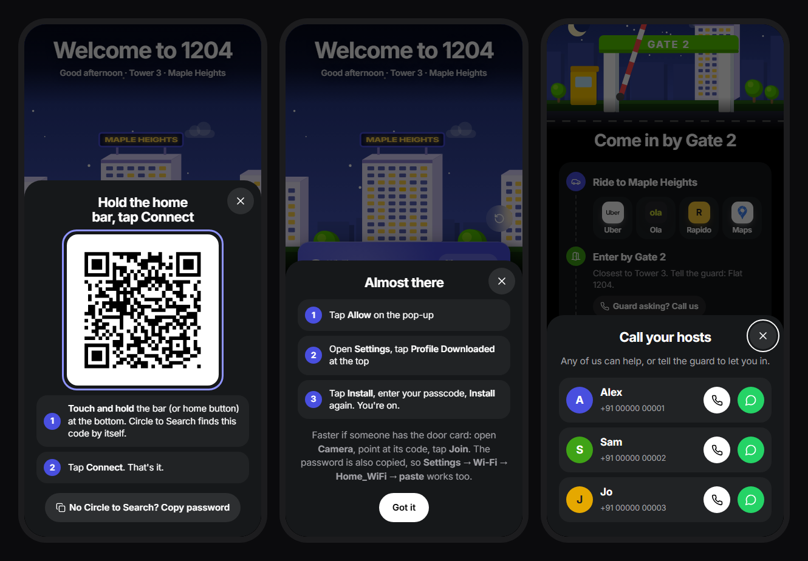
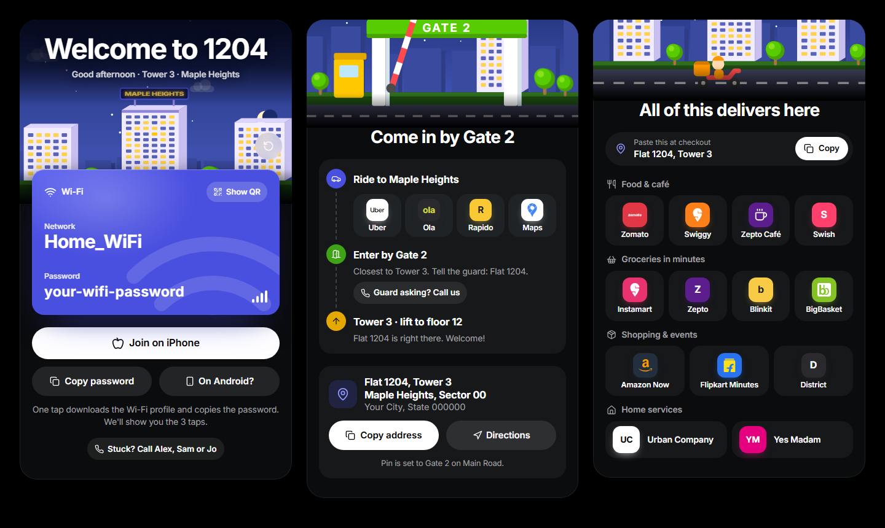
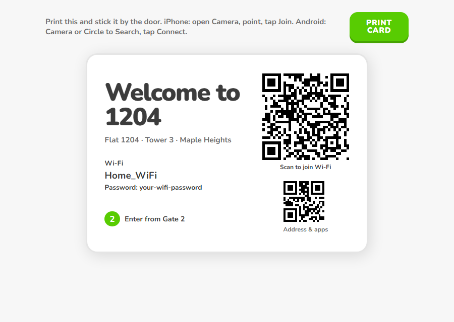

# Home Page App

*Working name. A guest web app for a flat in a gated society.*

> All screenshots use placeholder details (flat 1204, Maple Heights, Home_WiFi). The real ones live in a local file that never leaves the host's computer.

## What it does

Guests open one link on their own phone and everything they'd normally ask the host for is one tap away.

| | |
|---|---|
| **Welcome** | A short animated welcome: the society's towers rise, the lift climbs to your floor and the flat's window lights up. The full version plays the first time; after that it's a quick 2-second one. |
| **Wi-Fi** | **Android:** one tap shows a big Wi-Fi code. The guest holds the home bar (Circle to Search) and taps **Connect**. **iPhone:** one tap downloads a Wi-Fi profile *and* copies the password, then shows the three taps left. A printable door card gives a true camera one-tap on any phone. |
| **Arrive** | The route from the road to the door: ride here (Uber with the drop already set to the right gate, Ola, Rapido, Maps), which gate to use and what to tell the guard, then the lift. The address copies in one tap. |
| **Order** | Every food, grocery, shopping and home-service app that delivers to the society. Tapping one copies the full address and opens the app, ready to paste at checkout. |
| **Call** | A green call button on every screen: Call or WhatsApp any of the hosts, with the message already typed. |

## What it helped with

- **No more repeating the same messages.** "What's the Wi-Fi?", "Which gate?", "What's the full address?" are answered before anyone asks.
- **Guests get on the Wi-Fi in seconds.** The fastest path is different on Android and iPhone, so each phone gets its own. That came from testing what each phone actually does: Circle to Search reads a Wi-Fi code straight off the screen, while an iPhone can't join from its own screen.
- **Deliveries and cabs arrive at the right gate.** The map pin points at the exact gate, and the address pastes cleanly into every app.
- **Help is always one tap away.** Stuck at the gate? Call or WhatsApp a host from any screen.

## How it's built

- Plain HTML, CSS and JavaScript. No framework, no build step, loads fast on any phone.
- The society scene (towers, trees, birds, the gate and its car, the delivery scooter) is drawn in code as SVG, at night to match the black design.
- Duolingo-style motion: springy presses, staggered lead-ins, animated tab icons, confetti, and haptics (Android vibration, iPhone ticks on iOS 18+).
- Phone first: three swipeable screens with a floating tab bar. Desktop shows the three side by side.

## Use it for your own home

1. Copy `home.config.js` to `home.config.local.js` and fill in your flat, society, gate pin, Wi-Fi and hosts. That file is in `.gitignore`, so it never gets pushed.
2. Link the folder to your Vercel project once: `vercel link`.
3. Deploy with `node deploy.js`. It builds the profile and deploys your real details (Vercel would skip the git-ignored files otherwise).
4. Open `card.html` and print the door card.

| File | What it is |
|---|---|
| `home.config.js` | Placeholder details: the shape of everything the page shows |
| `app.js`, `scene.js` | Behaviour and the society illustrations |
| `make-wifi-profile.js` | Builds the iPhone Wi-Fi profile from your config |
| `deploy.js` | Deploys the site with your real, git-ignored details |
| `card.html` | The printable door card |
| `APP-LINKS.md` | How each app takes an address, and the one-tap Wi-Fi notes |
| `DESIGN.md` | The design system |
